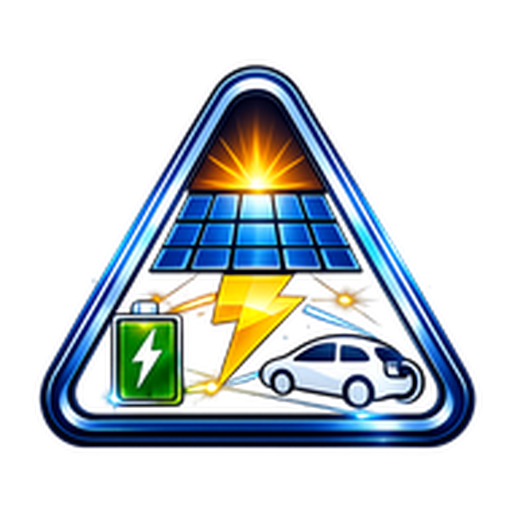
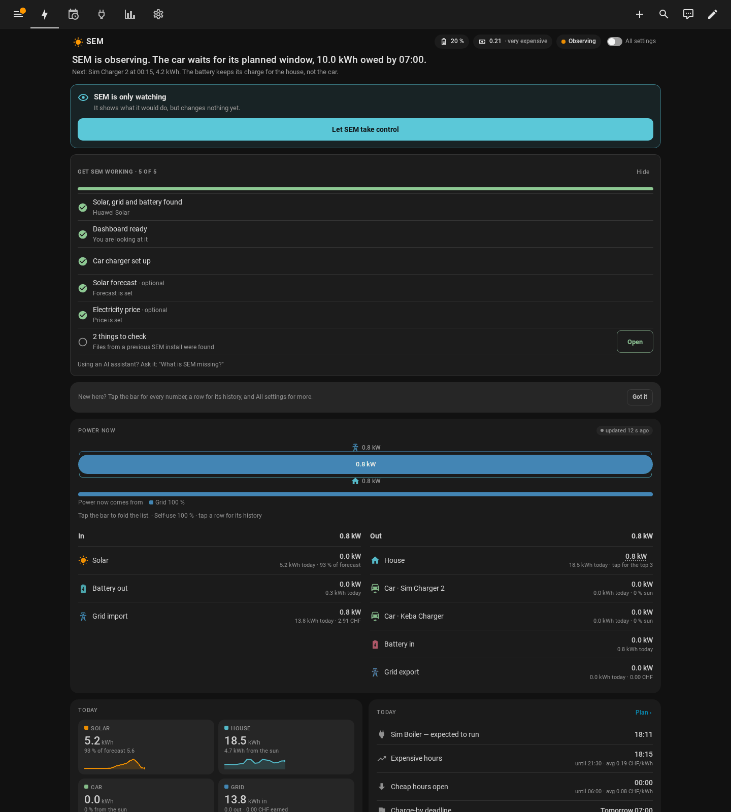
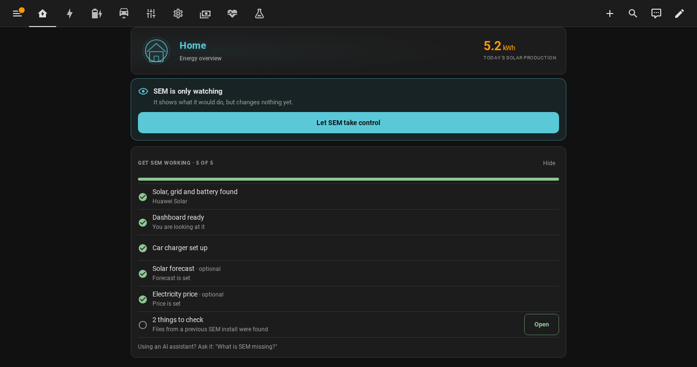
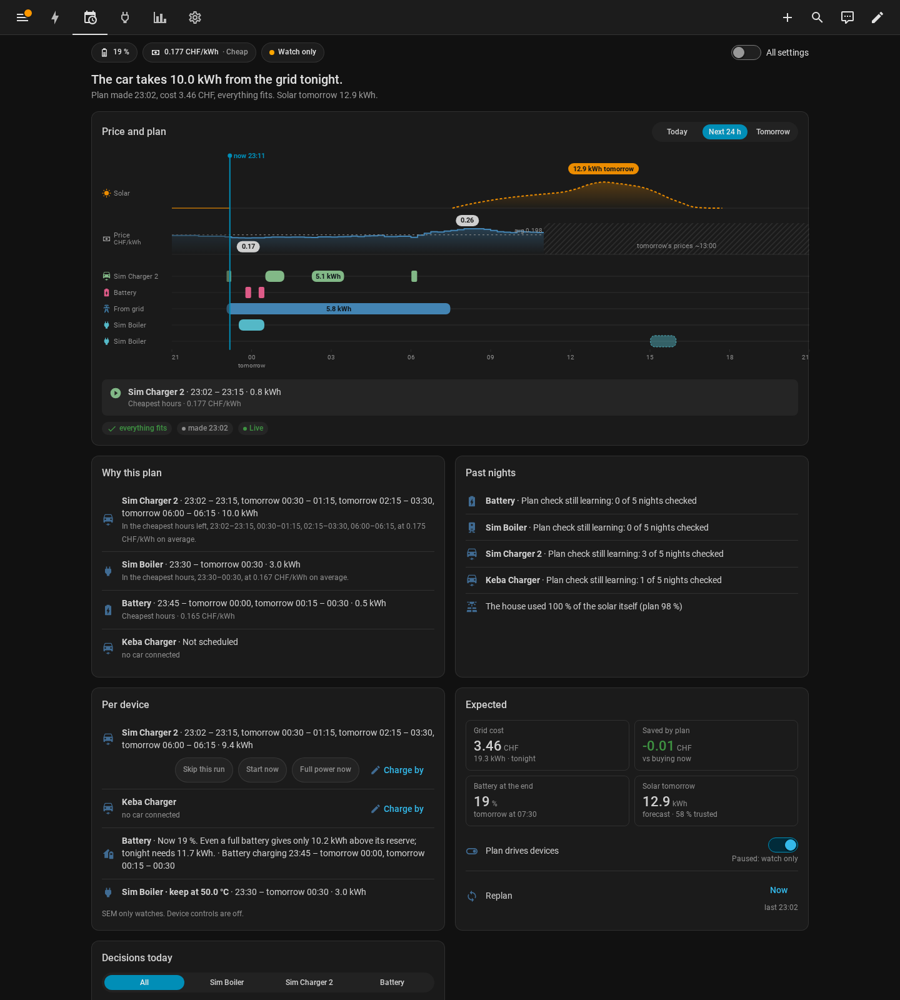
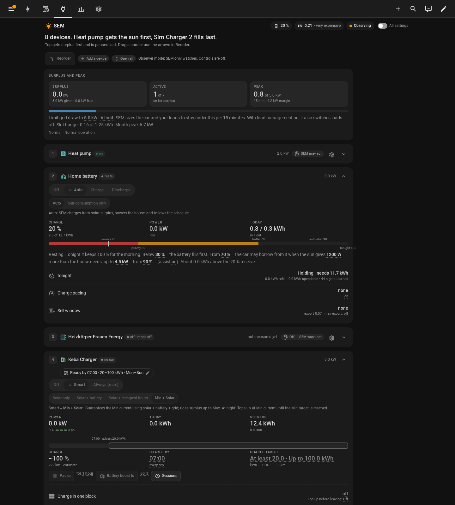
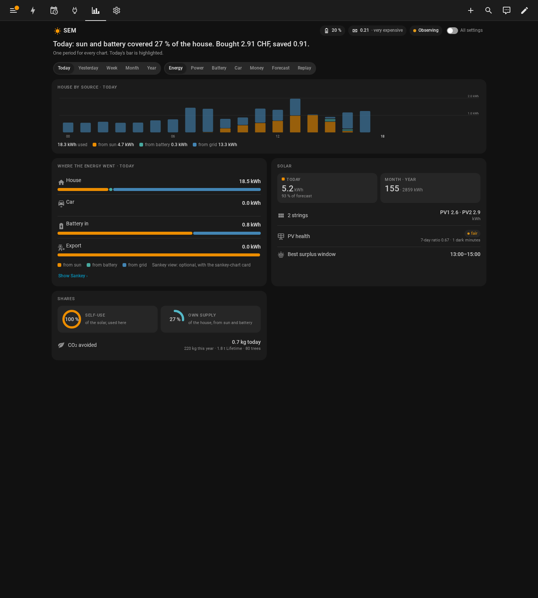
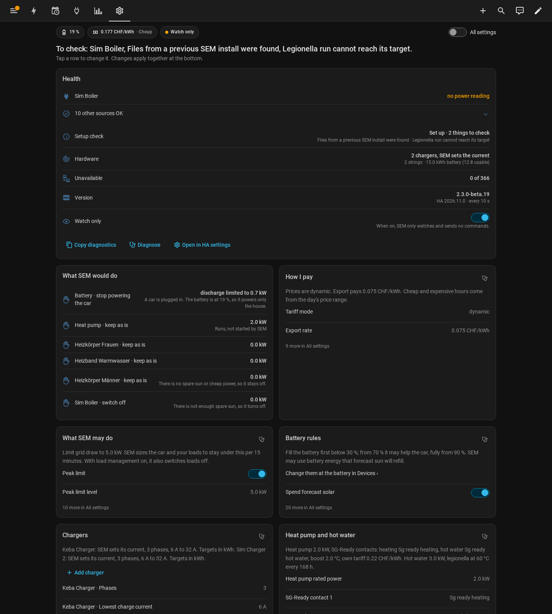
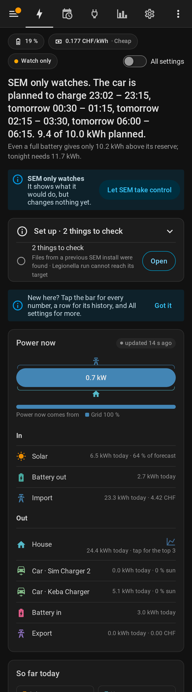
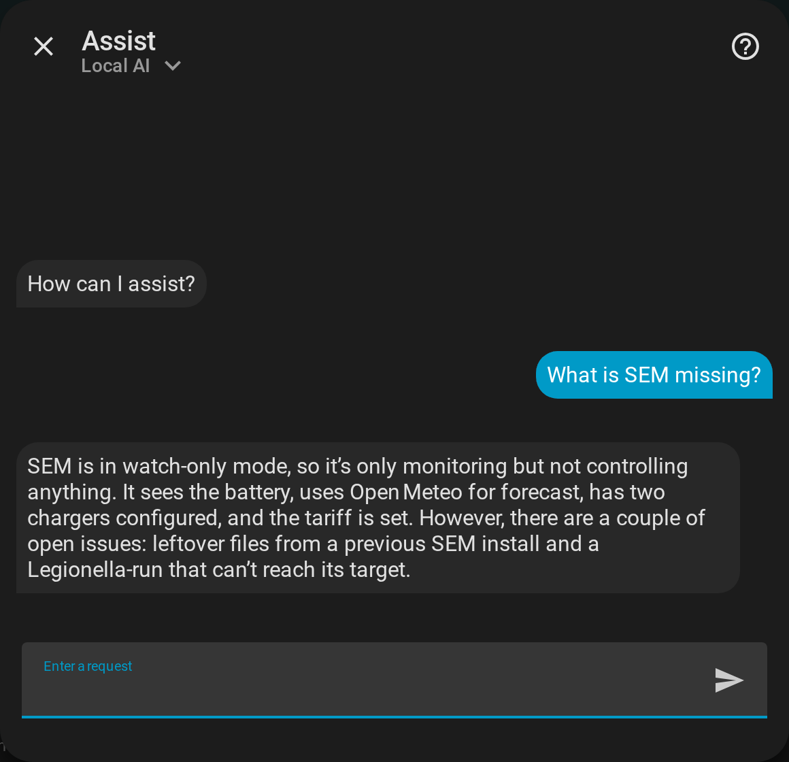
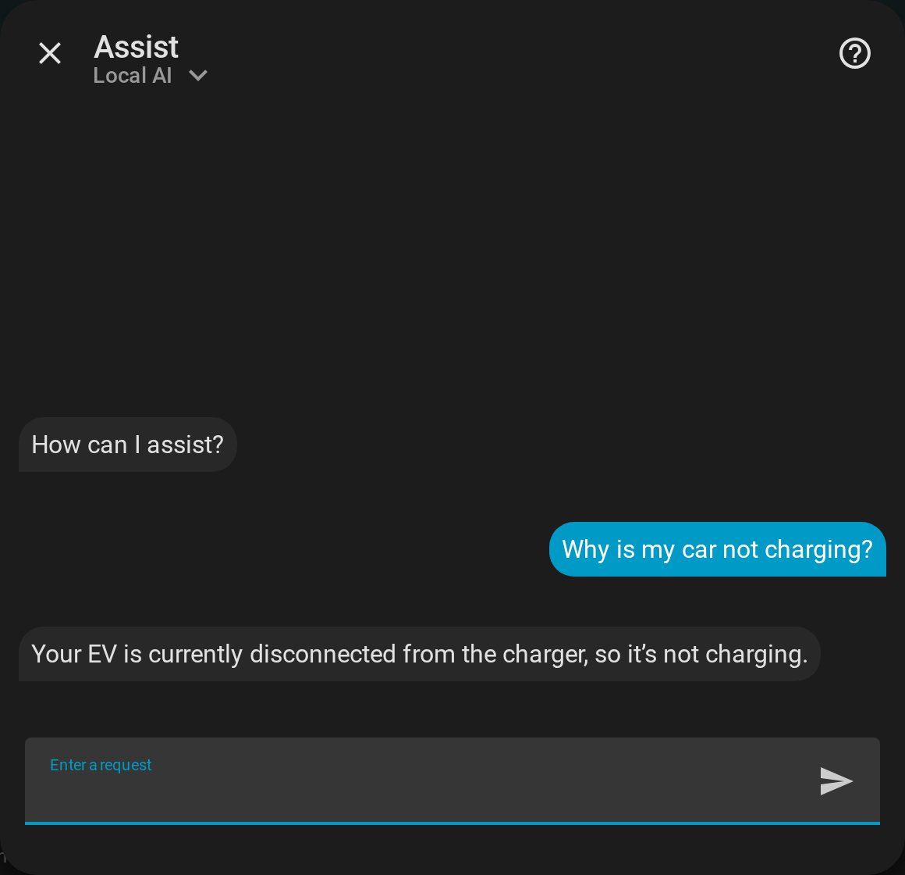

  

# Solar Energy Management (SEM)

[![GitHub Release][releases-shield]][releases]

[![GitHub Activity][commits-shield]][commits]
[![License][license-shield]](LICENSE)
[![hacs][hacsbadge]][hacs]

SEM manages your solar, battery, EV charger and household loads inside Home Assistant. It reads your sensors every 10 seconds and sends surplus power to the devices that need it, by priority. No cloud, no subscription: everything runs locally.

## What it does

- **Charges your car from surplus solar**, from 6 to 32 A. Four modes: **Sun**, **Sun + tariff**, **Now** and **Off**, and one switch for whether the home battery may help.
- **One owner per charger.** Every command to a charger goes through one place that knows who asked. A charger SEM stopped for safety is switched back on when there is room.
- **Plans with the forecast and prices.** Charges in the cheapest hours, and plans the battery around tomorrow's sun.
- **Shares surplus by priority** between the car, heat pumps, hot water and any switch you add.
- **Guards the grid peak** on demand tariffs, and pauses loads when the peak limit nears.
- **Starts in watch-only mode.** It shows what it would do and sends nothing until you turn it on.
- **Keeps charging sessions:** one list of the last 400 sessions for all chargers. Download it with **Download .xlsx** on **Insights**.
- **300+ sensors and entities**: SEM creates 250+ sensors for power, energy, costs, forecasts and devices.
- **Works with many brands.** See [Supported hardware](#supported-hardware).

## Install

**Requirements**

- **Home Assistant 2026.8.0** or newer
- HACS, or **Settings › Marketplace** on Home Assistant 2026.11 or newer
- A solar sensor and a grid sensor, both in watts. The Energy Dashboard is not required.
- Optional: a battery, an EV charger, a solar forecast, a dynamic tariff

**Steps**

1. In HACS, search for **Solar Energy Management** and select **Download**. On Home Assistant 2026.11 or newer, use **Settings › Marketplace**.
2. Restart Home Assistant.
3. Go to **Settings › Devices & services › Add integration** and add **Solar Energy Management**.

**Beta versions.** In HACS, open SEM, select **Redownload**, and turn on **Show beta versions**. Beta releases may have rough edges. Report problems on [GitHub](https://github.com/traktore-org/sem-community/issues).

**Manual install.** Copy `custom_components/solar_energy_management/` into your Home Assistant `config/custom_components/` folder, then restart.

## Getting Started

Each step is explained in the [Quick Start](docs/QUICK_START.md).

1. **Install SEM** from HACS, or from **Settings › Marketplace** on Home Assistant 2026.11 or newer.
2. **Restart Home Assistant.**
3. Go to **Settings › Devices & services › Add integration** and add **Solar Energy Management**.
4. **Confirm the sensors SEM found** (solar, grid and battery power, in watts). Choose your own if one is wrong.
5. Open **SEM-dashboard** (older installs: **Solar Energy Management**) in the sidebar. SEM made the dashboard for you.
6. **Add your EV charger** under **System › Chargers**. The wizard does not ask for it.
7. *Optional:* a **solar forecast** (Solcast, Forecast.Solar, Open-Meteo or Helios).
8. *Optional:* a **dynamic tariff** (Tibber, Nordpool, ENTSO-e or aWATTar).
9. **Turn watch-only off** when the dashboard looks right: press **Let SEM take control**, or turn off `switch.sem_observer_mode`. New installs start in watch-only mode, so **until you do this, SEM changes nothing**.
10. **Check Repairs** (**Settings › System › Repairs**) when SEM needs your attention.

The **Now** screen shows what SEM sees, what is left to set up, and one button to let SEM take control:

---

## The dashboard

The dashboard has 5 screens, one per question.

| | |
|---|---|
|  |  |
|  |  |
|  |  |

| Screen | What it shows |
|---|---|
| **Now** | What SEM does right now, and why. |
| **Plan** | The day as a timeline: sun, price and each planned block. |
| **Devices** | Battery, cars, heat pumps, tanks and loads. Each has its own settings. |
| **Insights** | History, charging sessions, costs, forecast accuracy and a replay of past days. |
| **System** | Setup check, sources, watch-only switch, and every setting as a row. |

Every setting is a row. Tap a row to change it. The dashboard is in 16 languages, in each user's Home Assistant language. See [Settings: where they live](docs/SETUP_GUIDE.md#5-settings-where-they-live).

## Ask your AI assistant

Home Assistant's AI assistant can use SEM's tools. Nothing to install.

| | |
|---|---|
|  |  |

- **Ask why:** why the battery or the car does what it does, and whether now is a cheap hour.
- **Ask what is missing:** watch-only mode, chargers, battery, forecast, price and Repairs.
- **Report a problem:** the assistant prepares a bug report with versions and recent warnings. You read it and post it yourself.
- **Change a plan** only after you turn on **Voice commands** in SEM.

Other AI apps, such as Claude Desktop or Claude Code, can use SEM through Home Assistant's **Model Context Protocol Server** integration. Connect the app to `http://<your-ha>:8123/api/mcp` with a long-lived token. The tools are named `solar_energy_management__SemWhyBattery` and so on.

## Supported hardware

The full list, with each brand's status, is in [Supported hardware](docs/SUPPORTED_HARDWARE.md). A brand marked *tested live* runs with SEM on real hardware.

**Solar inverters:** Huawei Solar, SolaX, DEYE/Sunsynk, Growatt, Sofar, Solis, Fronius, SMA, SolarEdge, Enphase, GoodWe, Tesla Powerwall, Kostal Plenticore, Sungrow, Victron, Sonnenbatterie, E3DC, GivEnergy, Fox ESS, Alpha ESS, Senec, RCT Power, KSTAR and FENECON Home. Any inverter with Home Assistant sensors can work. SEM detects the grid and battery sign conventions itself.

**Batteries:** Any battery behind a supported inverter integration, and standalone systems. Sessy (NL), Huawei LUNA2000 and Sonnen work automatically and are tested live. Tesla Powerwall reads automatically; its grid charge needs a setup step ([Setup Guide](docs/SETUP_GUIDE.md#battery-charged-by-its-operating-mode-or-backup-reserve)). BYD and others: see the hardware list.

**Battery discharge control auto-detected for:** Huawei Solar, SolaX (solax-modbus), DEYE/Sunsynk (ha-solarman), Growatt, Sofar, Solis, GoodWe, SolarEdge (solaredge-modbus-multi), Enphase (IQ Battery), Tesla Powerwall, Victron, Kostal Plenticore, Sungrow

**EV chargers:** KEBA P30, Wallbox (Pulsar and others), go-eCharger (HTTP and MQTT), Fronius/go-e Wattpilot, Easee, Zaptec, ChargePoint, Heidelberg Energy Control, OpenWB 2.x, OCPP chargers (ABB Terra, Vestel, Grizzl-E and others), Ohme, Peblar Rocksolid, V2C Trydan, Alfen Eve, Blue Current, OpenEVSE, NRGkick, GARO and JuiceBox 48. SEM also proposes a charger from its integration's own entities when the brand is not in this list.

**Heat pumps:** SG-Ready heat pumps, and pumps with a climate entity for setpoint boost. **Hot water:** water heaters and boilers exposed as a switch, climate or water heater entity. **Meters:** Shelly EM and Pro, DSMR smart meters (NL and BE), and any Home Assistant meter with power sensors.

> **Note:** Fronius and SMA core integrations are read-only for battery control. Discharge limits need the Modbus variant, for example `fronius_modbus`.

> **Note:** KSTAR inverters work through [ha-solarman](https://github.com/davidrapan/ha-solarman) with KSTAR YAML profiles. Grid charging on KSTAR is not yet confirmed on real hardware.

## Documentation

| Guide | For |
|---|---|
| [Quick Start](docs/QUICK_START.md) | Set up SEM in about 10 minutes |
| [Setup Guide](docs/SETUP_GUIDE.md) | Each setup step, and where each setting lives |
| [Dashboard Guide](docs/DASHBOARD_GUIDE.md) | The five screens and their cards |
| [User Guide](docs/USER_GUIDE.md) | Every setting and every decision, explained |
| [Multi-Device Guide](docs/MULTI_DEVICE_GUIDE.md) | Several inverters, chargers or heaters |
| [Supported hardware](docs/SUPPORTED_HARDWARE.md) | Status of each brand |
| [Troubleshooting](docs/TROUBLESHOOTING.md) | Symptoms, causes and fixes |
| [Architecture](docs/ARCHITECTURE.md) | For developers and contributors |

## Community

- **Problems and ideas:** [GitHub issues](https://github.com/traktore-org/sem-community/issues).
- **Contributing:** read [CONTRIBUTING.md](CONTRIBUTING.md) first. Open pull requests against `develop`.
- **Dutch and Belgian readers:** articles on SEM and home energy are at [smart-energy-management.nl](https://smart-energy-management.nl).
- **Support SEM:** 

## License

MIT License. See [LICENSE](LICENSE).

---

[releases-shield]: https://img.shields.io/github/release/traktore-org/sem-community.svg?style=for-the-badge
[releases]: https://github.com/traktore-org/sem-community/releases
[commits-shield]: https://img.shields.io/github/commit-activity/y/traktore-org/sem-community.svg?style=for-the-badge
[commits]: https://github.com/traktore-org/sem-community/commits/main
[license-shield]: https://img.shields.io/github/license/traktore-org/sem-community.svg?style=for-the-badge
[hacsbadge]: https://img.shields.io/badge/HACS-Custom-orange.svg?style=for-the-badge
[hacs]: https://github.com/custom-components/hacs
