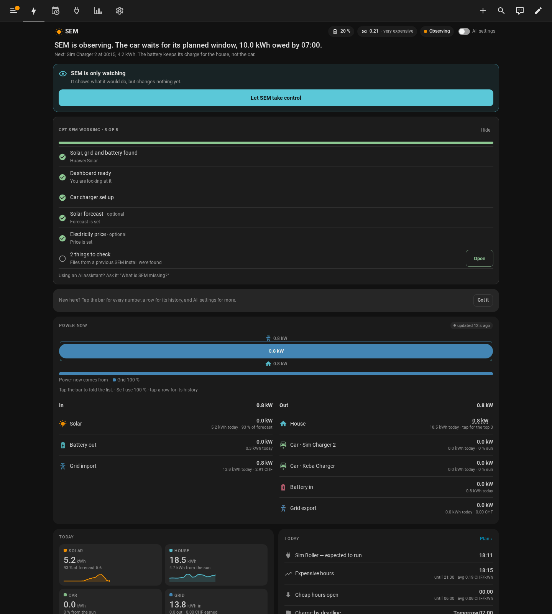
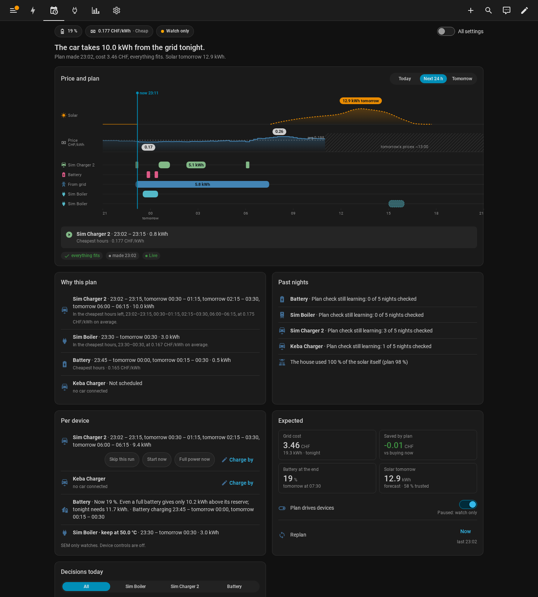
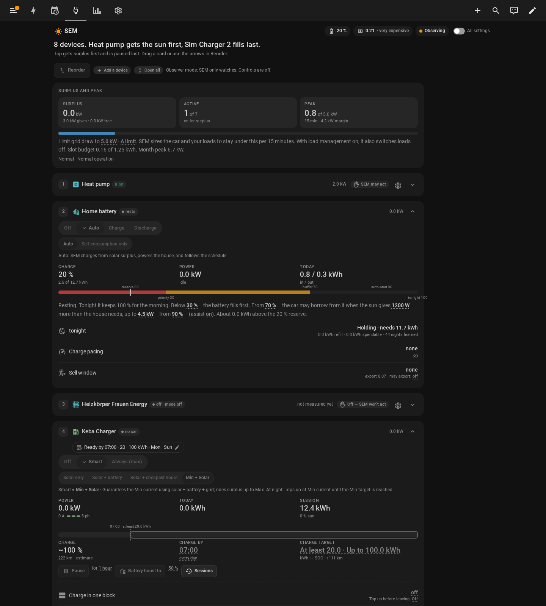
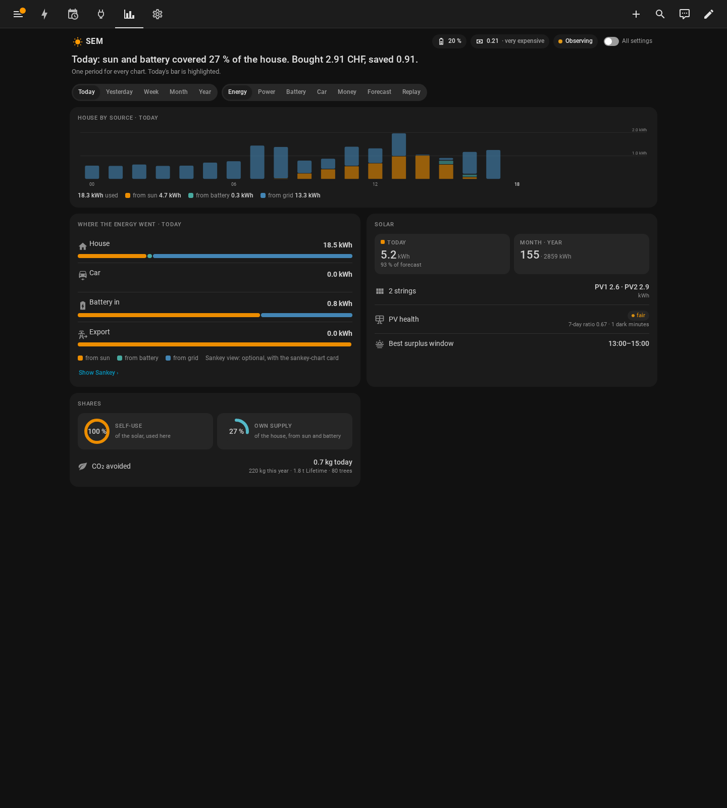
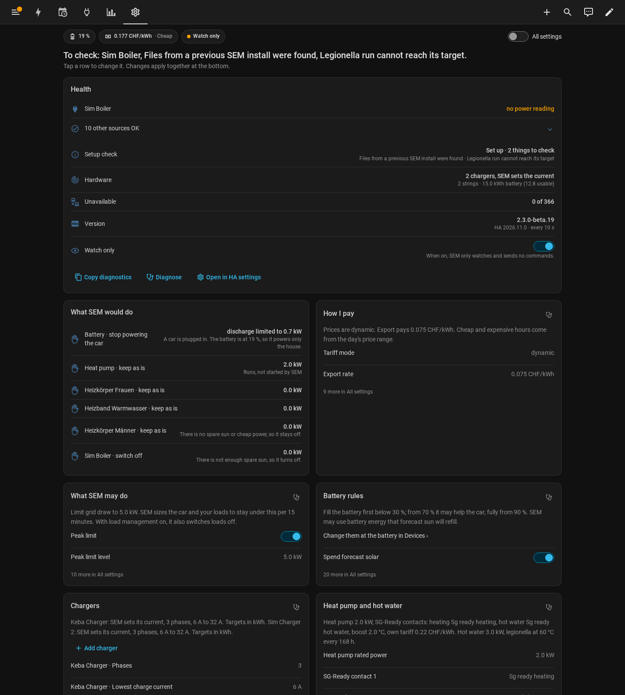
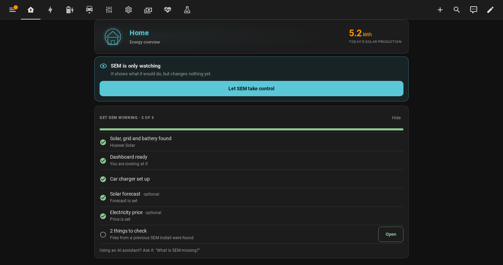
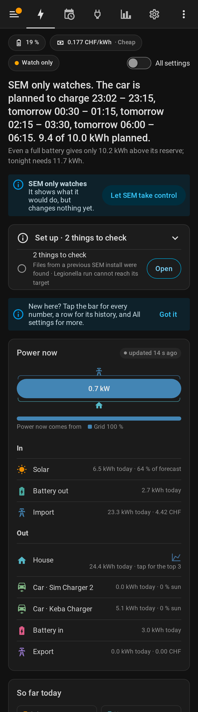

  

# Dashboard Guide

The SEM dashboard has five screens: **Now**, **Plan**, **Devices**,
**Insights** and **System**. It is the only SEM dashboard. It shows only the
hardware you have. For daily use and settings, see the [User Guide](USER_GUIDE.md).

## Contents

1. [Open the dashboard](#open-the-dashboard)
2. [Now](#now)
3. [Plan](#plan)
4. [Devices](#devices)
5. [Insights](#insights)
6. [System](#system)
7. [Card reference](#card-reference)
8. [Themes](#themes)
9. [Phone](#phone)
10. [Required HACS Cards](#required-hacs-cards)
11. [Coming from the classic dashboard](#coming-from-the-classic-dashboard)
12. [Language](#language)
13. [Troubleshooting](#troubleshooting)

---

## Open the dashboard

- The dashboard is built on first install. It is called **SEM-dashboard** in the sidebar (older installs: **Solar Energy Management**).
- To build it again: **Developer tools > Actions**, run `solar_energy_management.generate_dashboard`,
  then hard-refresh the browser (Ctrl+Shift+R).
- Each screen has its own address, for example `/sem-next/now`. The links between screens work from any address.

---

## Now

What SEM is doing right now, and why.

- **Setup checklist**: at the top until setup is done. See [sem-setup-checklist-card](#sem-setup-checklist-card).
- **Power flow**: sources above, uses below. Tap for the numbers.
- **Today**: totals with hourly sparklines.
- **Devices**: one line per device, with its reason.
- **Money**: the price now, and the next cheap window.
- **Signals**: tip, peak, CO₂, score and weather.
- A chip per device opens **Devices ›**.

A sensor that is missing leaves its row out.

---

## Plan

The next 24 hours as one timeline.

- The price line shows cheap and dear hours, in 15-minute steps if your tariff
  has them. The scale starts just below the cheapest price, so small steps show.
  The labels give the real prices.
- The sun forecast is a curve.
- Blocks show planned runs. Solid blocks are running. Dashed blocks are planned.
  Tap a block for its reason.
- **Show timeline per device** opens one lane per charger and load.
- **Why this plan**: one line per planned device.
- **Per device**: **Skip**, **Start now** and **Back to plan** for a car, **Charge now**
  (full power until you go back to the plan), and **Sell** for the battery.
- **Expected**: cost, savings, and the battery level at the end of the plan.
- **Decisions today**: the log with a device filter. **Replan** runs the planner again.

On a phone the timeline fits the width. It never scrolls sideways.

---

## Devices

Every charger, battery and load, in priority order.

- Each card shows rank, name, state, live kW and a configure button.
- **Reorder** moves cards by drag or with the arrows. **Done** saves the order.
- Above the list: surplus, active devices, the 15-minute peak, the limit
  (**Limit grid draw to**), the month peak and what SEM can shed.

**Charger**: mode, target bar (**At least**, **Up to**), **Charge by**, **Pause charging**,
sessions and lifetime. **Battery**: mode, what it does now and next, the three levels.
**Load**: one mode control and **Boost for**. A load does nothing until you set
its mode; new loads start at **Off**. Security devices (camera, alarm, lock,
siren) are never listed or offered. **Heater**: the four questions. See
[A heater's four questions](USER_GUIDE.md#a-heaters-four-questions).

Every card starts folded on a phone. The pill is the one-line summary.

---

## Insights

How it went.

- One period for every chart: **Today**, **Yesterday**, **Week**, **Month**, **Year**.
- Tabs: **Energy**, **Power**, **Battery**, **Car**, **Money**, **Forecast** and **Replay**.
- Tap or move across a chart to read one bar.
- **Money** shows the average price paid, when the tariff gives it.
- **Replay** runs the simulation. See the [User Guide](USER_GUIDE.md#replay-simulation).

---

## System

Is everything connected, and every setting as a row.

- **Health**: a tile for each source with its value and age. Each tile shows the entity SEM reads.
  The **watch only** switch is here. **Copy diagnostics** and **Diagnose** are here too.
- **Setup check**: the grid and battery signs, and what is unavailable.
- **Detected hardware**: what SEM found, and what it could not map.
- What SEM held back.
- Seven groups of settings. Each group is a sentence and then rows. See the
  [User Guide](USER_GUIDE.md#settings).
- **All settings** shows the rest.
- Changes collect. **Apply** at the bottom saves them together.

---

## Card reference

Each card has its own section. The heading is the card's element tag, so the
help link in the card editor lands on it.

#### sem-next-now-card

The **Now** screen. See [Now](#now).

#### sem-next-plan-card

The **Plan** screen. See [Plan](#plan).

#### sem-next-devices-card

The **Devices** screen. See [Devices](#devices).

#### sem-next-insights-card

The **Insights** screen. See [Insights](#insights).

#### sem-next-system-card

The **System** screen. See [System](#system).

#### sem-setup-checklist-card

Top of **Now** until setup is done. In watch only it shows **Let SEM take
control**. That button asks first, then turns watch only off. **Hide** folds
the list in this browser.

#### sem-simulation-card

The Replay tab on **Insights**. See the [User Guide](USER_GUIDE.md#replay-simulation).
It appears when **simulation tab** is on, under **System > All settings**.

#### sem-retired-card

A card of the classic dashboard, placed on your own dashboard, shows one line:
"This SEM card was retired. Use the SEM dashboard." with a link. Remove the card to clear it.

---

## Themes

- The dashboard follows Home Assistant's theme, in light and dark.
- The energy colours are the same on every card and chart:

| Source | Colour |
|---|---|
| Solar | Orange `#ff9800` |
| Grid import | Blue `#488fc2` |
| Grid export | Purple `#8353d1` |
| Battery charge | Pink `#f06292` |
| Battery discharge | Teal `#4db6ac` |
| Home | Cyan `#5BC8D8` |
| Car | Green `#8DC892` |

---

## Phone

- Layout works at phone width with no sideways scrolling.
- Cards start folded. The state pill is the summary.
- The Plan timeline fits the screen width.
- Long choice lists become one chip. Tap it to open a picker.
- The Replay days sit in one row. Swipe them sideways.

---

## Required HACS Cards

**None.** Every card on the dashboard is bundled with the integration. No card install is needed.

---

## Coming from the classic dashboard

The classic dashboard had nine tabs. It is gone. On the first start after the
update, SEM looks at it once:

- **You never edited it**, and the SEM dashboard exists: it is removed.
- **You never edited it**, and there is no SEM dashboard yet: it is rewritten
  as the SEM dashboard, at the same address and in the sidebar.
- **You edited it**: it stays. Its SEM cards show a link to the SEM dashboard.
  A Repair, **Old SEM dashboard is still there**, offers to delete it.

SEM cannot see who edited a dashboard. It counts a dashboard as unedited only
when every view and card is a classic one, with nothing added. In doubt, SEM
keeps it.

The service `solar_energy_management.generate_dashboard` still takes
`template: classic`. It builds the SEM dashboard and logs a warning.

---

## Language

- SEM's own text follows the user's Home Assistant profile language.
- Section titles that are built once follow the system language. Build the
  dashboard again after you change the system language.
- SEM supports 16 languages. Simplified Chinese is `zh`.

---

## Troubleshooting

| Problem | What to do |
|---|---|
| Dashboard not in the sidebar | Run `solar_energy_management.generate_dashboard`, then hard-refresh |
| "Custom element doesn't exist" | Restart Home Assistant, then hard-refresh |
| A card says it was retired | Remove the card, or open the SEM dashboard from its link |
| Blank screen after an update | Hard-refresh (Ctrl+Shift+R). On the Companion app, clear its frontend cache |
| Entity not found | Wait for the first cycle (about 10 seconds after a restart), then refresh |
| Cards show old behaviour | Hard-refresh. SEM adds `?v={version}` to each card URL |
| Mixed languages | System language and profile language differ. Set both to the same language and build the dashboard again |
