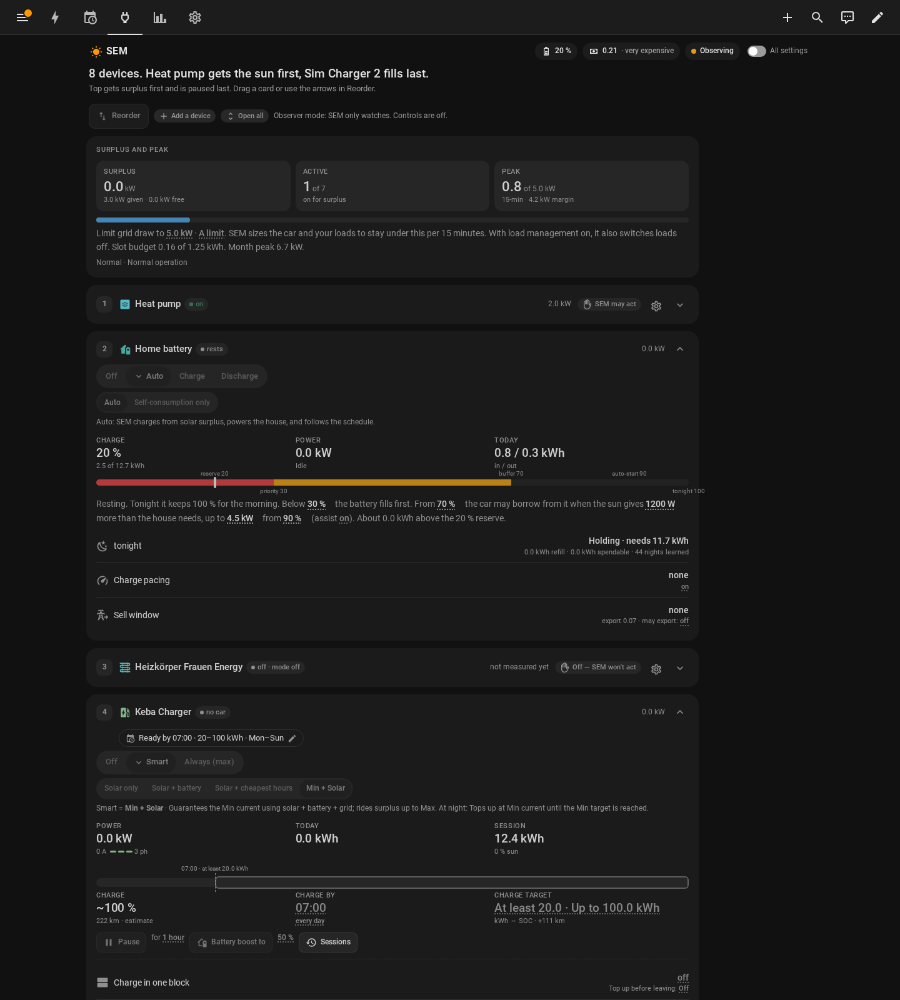

# EV charging: how SEM decides



SEM decides for each charger every 10 seconds. You set the behaviour with one
**Charge mode** per charger, on the **Devices** screen. The other settings are
on the **System** screen, group **Chargers**.

## Charge modes

Default: **Min + Solar**.

| Mode | Grid | Home battery | What it does |
|---|---|---|---|
| **Solar only** | Never by day. At night only with an *At least* floor you set on this charger | Never for the car. Exception: forecast-led spending | Spare sun only. Idles at night unless you set a floor. |
| **Solar + battery** | Never by day. At night only with an *At least* floor | Helps down to the higher of the Buffer SOC and tonight's floor | Spare sun plus the pack. Above the spare-sun threshold it always helps. Below it, only when tonight's forecast budget is positive. |
| **Solar + tariff** | Up to the floor, when it costs least | Never | Spare sun by day. Grid by day at cheap, very cheap or negative prices, and with thin sun when the blended price beats the cheapest hour to come. Works on every tariff. |
| **Min + Solar** | Up to the floor (*At least*) | Helps above the Buffer SOC | Tops up to *At least* by the *Charge by* time. Spare sun adds up to *Up to*. Nothing owed means no grid. |
| **Always (max)** | Whatever it takes | Held to the house, unless the pack is above the Buffer SOC and spare sun passes the threshold | Full speed whenever a car is plugged in, day or night, at any price. Stops at *Up to*. A floor of 0 does not stop it. |
| **Off** | None | None | Hands-off. Switching to Off stops a running charge once, whoever started it. Then SEM sends nothing: no start, no stop, no current. SEM still reads the power and counts the energy. |

- A charge that you start elsewhere in Home Assistant runs untouched, also
  after a restart, while the mode is Off.
- Solar + battery: until the battery learner has gathered enough nights, the
  charger assists from live surplus only. The card says so.

## Night charging: the At least floor

*At least* is the only control for night charging. A floor of 0 means no
overnight charge in every mode except **Always (max)**.

- **Units.** A kWh target goes from 0 to 200 kWh. A car charge % target goes
  from 0 to 100 %.
- **Solar only.** The floor counts only when you set it on that charger. A
  global default in the setup does not opt a Solar-only charger in. The other
  night-capable modes follow the global default.
- **Solar from sun only, never grid at night.** Set *At least* to 0 % and
  *Up to* to 100 %. Daytime surplus then charges up to the ceiling, and nothing
  tops up overnight.
- *Up to* is never below *At least*.

## Per-charger settings

| Setting | Visible name | What it does |
|---|---|---|
| Charge target | *At least* / *Up to* | The floor and the ceiling of the target (kWh or car charge %) |
| Deadline | *Charge by* | The time the car must be ready. Earlier than the night end forces the charge. Later: the night still ends at its window end |
| Finish by departure | *finish by departure* (More) | Off by default. After the night end, the floor keeps charging from grid at the day price, at the current that makes the *Charge by* time. Sun still wins when it offers more |
| Current range | *Lowest charge current* / *Highest charge current* | Lowest 6 to 16 A. Highest 6 to 80 A |
| Hardware | *Start/stop entity*, *Current control entity*, *Charge-mode / force-state select* | How SEM starts, stops and sets the current. Without a start/stop control, a charger that takes only a current may not stop |
| Battery may charge the car | *Battery may charge the car* | Per charger, on by default. It can only restrict, never override a battery you have declared off-limits to cars |

Limits: SEM never goes above the charger's own rating. A current limit may
ask for less than the hardware allows, never for more.

If the charger takes its current through a select that offers only some steps
(for example 8, 10, 12 A), SEM picks the largest step at or below the wanted
current.

## How a decision becomes amps

Each 10-second cycle, for each charger:

1. **Decision.** SEM works out the intent from this charger's own view.
2. **Stability filter.** Median smoothing, enable and disable delays, and the
   start ladder. The ladder offers 6 A and raises it to about 10 A until a
   fussy car starts.
3. **Backoff.** After 3 declined start ladders in a row, SEM waits 20 minutes
   before it offers again. Each further refusal doubles the wait, up to a cap.
   The wait ends at once when the car draws, when you plug in again, or when
   you change the mode.
4. **Reconciler.** SEM sends the fewest hardware commands that reach the wanted
   state, then leaves the charger alone.

The strategy sensor, `sensor.sem_charging_strategy`, says why in plain words.

The power reading is cleaned first. A median of 3 smooths out one bad read. A
sudden drop to under 5 % of the last value is held for at most 2 cycles while
the charger still says it charges.

## Night planner

Every 10 seconds in the night window, for each charger:

1. If the minimum is reached, the charger idles. It only tops up from surplus.
2. Required current = remaining kWh ÷ hours left ÷ watts per amp, clamped to
   the current range. The hours run to the *Charge by* time.
3. If a forced deadline applies, the rate is the *Highest charge current*.
   Otherwise it is the peak-managed rate.
4. If the energy plan covers the car tonight, SEM charges inside the plan's
   block and waits outside it.
5. If no fresh plan exists, SEM charges at the deadline current. It does not
   wait. The strategy sensor says *reactive, no plan yet*.

Example: Min + Solar, 8.5 kWh owed, deadline 07:00, plugged in at 22:00. The
need is about 1.4 A, so SEM offers the 6 A minimum. The car finishes around
02:00 and SEM idles until 07:00.

## Battery assist

The home battery can feed the car when solar is not enough.

| Setting | Visible name | Effect |
|---|---|---|
| Buffer SOC | *Buffer SOC* | The battery helps the car only above this level. Below it the battery is off-limits to the car |
| Spare sun before the battery helps | *Spare sun before the battery helps* | The real surplus (solar minus house) needed before the battery helps, in every mode. Default 1200 W. Set 0 to allow it at any time, also at night |
| Battery → EV assist limit | *Battery → EV assist limit* | The most the battery may give the cars. One allowance for the whole house |

- With the battery at or above the Buffer SOC and the surplus past the Solar
  Gate, SEM offers the full assist. The inverter then discharges the battery
  into the car, down to the Buffer SOC. Below the Buffer SOC the assist
  tapers to zero.
- SEM sends no battery command. Only the amps change.
- **Who spends it first.** The device list order decides. A load above the
  charger gets its share first. A load set to *Finish overnight from: Battery*
  reserves nothing against a car.
- Battery help applies in Solar + battery and Min + Solar. Solar only does not
  use the pack for the car, except with forecast-led spending. Always (max) gets
  no assist amps.

**Forecast-led spending.** It never lets the battery feed a Solar-only
car. The battery stays with the house, and the grid pays for the car's floor
charge. Only a *Solar + battery* charger lets the battery cover the car, down
to the Buffer SOC or tonight's floor, whichever is higher.

**Battery redirect.** Part of a measured battery charge may be credited to the
car, if the inverter will pass it on. A commanded battery charge (forced or
scheduled) is never credited. Three cycles of sustained grid import with a
redirect in the budget turn the redirect off for the rest of the plug-in.

## Cheapest hours

| Mode | Time | What happens |
|---|---|---|
| Solar + tariff | Day | Tops up the floor from grid at cheap, very cheap or negative prices. Solar surplus wins when it offers more. A static tariff (no live price level) never triggers it |
| Solar + tariff | Day, thin sun | Charges at the minimum on spare sun plus grid when that blend costs less than the cheapest hour to come. Needs an export price and a forecast. See below |
| Min + Solar | Day | Drops the Min grid guarantee at expensive prices. Resumes at a lower price or with enough sun |
| Any tariff mode | Night | Waits for the energy plan's charge block |
| Solar only, Always (max), Off | Any | No effect on price |

The thresholds *Cheap below* and *Expensive above* set the price levels when no
dynamic tariff gives them. See [ENERGY_PLANNER.md](ENERGY_PLANNER.md) for the plan.


### Thin sun plus grid

Spare sun below the charger's minimum power cannot charge the car alone.
In **Solar + tariff** the car may charge at its minimum on that sun plus the
grid, for the floor only. One sum decides, in `coordinator/thin_sun.py`:

```
blended = (sun × export + (min − sun) × import now) / min
```

The invariant: it fires only when `blended` is at least 10 % below the
cheapest hour without spare sun that the car may still use before its
deadline (5 % to keep a running session). On a one-price tariff that
reduces to "export below import":

- export = import: never.
- one price, export below import: from enough sun to save 10 %
  (0.30 and 0.075, a 4.14 kW minimum: about 550 W).
- a cheaper night: only from more sun.

On a dynamic tariff it can fire with an export price above this hour's
import price: when this hour is the cheapest of the window, buying now is
cheaper than later.

The export price is the stored `electricity_export_rate`. It is unknown
only when the key is absent or not a number; then the rule is off.

It does not fire when no forecast is known, when strong sun later today
covers the floor, when the battery charges from that sun or may feed the
car, in an expensive hour, or when the peak limit has no room.

Plan and charger: the planner asks the same functions
(`energy_planner._sun_grid`) and books a **Spare sun plus grid** block.
The charger acts only inside such a block of the stamped plan. With a home
battery the plan books one only where its walk has the battery full, so
where the plan shows none the charger does not act.

Steady: a started session holds for the charger's minimum block
(`ev_min_block_minutes`) over soft conditions: a sun dip, a price between
the two margins, a battery hovering at its veto, a block that moved. After
the block every soft condition has a start value and an easier "keep
running" value. Strong sun in between keeps the session: the car charges
on the sun alone, and back under the minimum it is the same session.

Hard limits end a session at once, inside the minimum block too
(`thin_sun.HARD_LIMITS`): the floor is met, the car is unplugged, the hour
turns expensive, the peak limit sheds, the home battery feeds the car or
plainly charges from that sun, the export price is no longer below the
alternative, the spare sun stays under the run floor for three minutes, or
a price cannot be read for five minutes.

A session also ends with the charge mode, at night, with any charge the sun
does not fund (a night block, a deadline, Start now), and one minimum block
after the end of its plan block.

A re-stamped plan may move the block: a running session keeps going when
the plan still books thin sun now or in the next slot. A plan older than
the planner's own limit (24 hours), or without a stamp time, books nothing.

Two things are accepted as they are. The plan's slot price and the live
price can differ for up to one 15-minute slot; the 10 % margin covers it.
The export price is pre-filled with 0.075 at setup; the guide says it must
be right for this mode, and the margin keeps a rough number from buying
grid power for a small saving.

After a restart the rule is off until the next plan is stamped (a new day,
a plug-in, a changed need). That is safe: off means the mode's old
behaviour, spare sun by day and the floor at night.

## Daily energy counters

- Each charger has its own daily counter, `sensor.sem_charger_<id>_daily_energy`.
  It rolls over at that charger's *Charge by* time, not at sunrise. A sunrise
  reset could start the night charge again after the target was met.
- The fleet total, `sensor.sem_daily_ev_energy`, rolls over at the shared
  *Charge by* time. If the chargers have different times, it rolls over at
  midnight.
- Moving a *Charge by* time does not reset the running day. The new time
  applies from the next rollover.
- A charger counter that jumps at plug-in does not count as charging if SEM
  saw the charger draw nothing in that time.

## Heat pump: SG-Ready wiring

SEM drives a heat pump through two switch-like entities that flip between on
and off. Pick one of two wiring paths. SEM treats both the same way.

**Path A: physical relays.** Use this for a heat pump with only a relay pair as
its SG-Ready input.

1. Wire two relays to the heat pump's two SG-Ready inputs.
2. Check that both switches show in Developer Tools and toggle correctly.
3. On the **System** screen, group **Heat pump and hot water**, set *SG-Ready
   contact 1* and *SG-Ready contact 2* to the two switches.

SEM sets the four SG-Ready states through the standard contact pairs. BLOCKED is
1:0 and NORMAL is 0:0. If your contacts are normally closed, turn on
*invert contacts* instead of rewiring.

**Path B: Modbus or vendor integration.** Use this when the heat pump offers
SG-Ready through a register or a cloud API.

1. Install the integration that exposes the SG-Ready register.
2. Create two template switches. Each writes one bit of the state and reads it
   back.
3. Point *SG-Ready contact 1* and *SG-Ready contact 2* at the template switches.

**Check the wiring.** The sensor `sensor.sem_heat_pump_registration_status`
shows the mode: `registered_sg_ready` (relays only), `registered_climate_only`
(climate entity only) or `registered_sg_ready_and_climate` (both). Its state
also names a wiring fault, such as a missing or unavailable entity. Download the diagnostics to
see the resolved entities and their live states.

## Phase switching

Some wallboxes switch between 1 and 3 phases. SEM supports three levels.

- **Active phases (estimate).** SEM divides the measured power by the
  commanded amps to estimate the phases the car uses. It is shown in
  `sensor.sem_charging_state`, attribute `per_charger_phases`.
  If the charger has its own current sensor per phase, SEM reads those first.
  So amps and phases are right even when another system charges the car.
- **Phase switch entity.** Name the wallbox's phase control with *Phase switch
  entity*. SEM checks that it exists and is a select, number or switch.
  - For a select, fill in *1-phase value* and *3-phase value* with the option
    names the device uses. For a number the defaults are 1 and 3. For a switch
    they are off and on.
- **Current per phase.** Some chargers (for example an Easee) take one current
  per phase through a service. SEM finds that service itself. A phase at 0 A is
  off.

**Phases select.** Naming a phase control adds the select `Phases` on the
charger's row, with the options *Auto*, *1-phase* and *3-phase*. Picking 1 or 3
runs the one safe sequence: stop, switch, settle for 60 seconds, start. There
is always at least 2 minutes between two switches.

**Auto.** With *Phase switching* on and the phase set to *Auto* (default):

- Down to 1 phase after 10 minutes below the 3-phase minimum (about 4.1 kW at
  6 A).
- Up to 3 phases after 5 minutes of headroom above it, with a 10 % margin.
- At most one automatic switch per 30 minutes, and 4 per charging session.

*Phase switching* is off by default.

## Curtailment probe

Some inverters cap grid export, for example at negative prices. Solar then
stays hidden: the measured surplus reads about 0 W while the array could give
more. The probe starts the car at minimum amps to make the hidden power show.

Set it in the integration options, step **EV Charging & Solar**: *Curtailment
probe (harvest limited solar)*. It is off by default. The optional *Export-limit
entity* is auto-detected for many brands. A forecast integration (Solcast,
Forecast.Solar or Open-Meteo) is required.

1. **Suspect.** The forecast says much more solar than the array makes, export
   is near 0 W, and production is about equal to consumption.
2. **Probe.** SEM starts the car at minimum amps. If production rises within
   2 minutes, the limit was real. If not, the probe stops and waits 15 minutes
   before it tries again.
3. **Harvest.** When production follows, SEM raises the amps one step at a
   time. Each step must be followed by a rise in production.

## Troubleshooting

See [TROUBLESHOOTING.md](TROUBLESHOOTING.md) for the common EV symptoms, such
as an idle car, a tariff wait that never ends, or a strategy message about
backoff.
