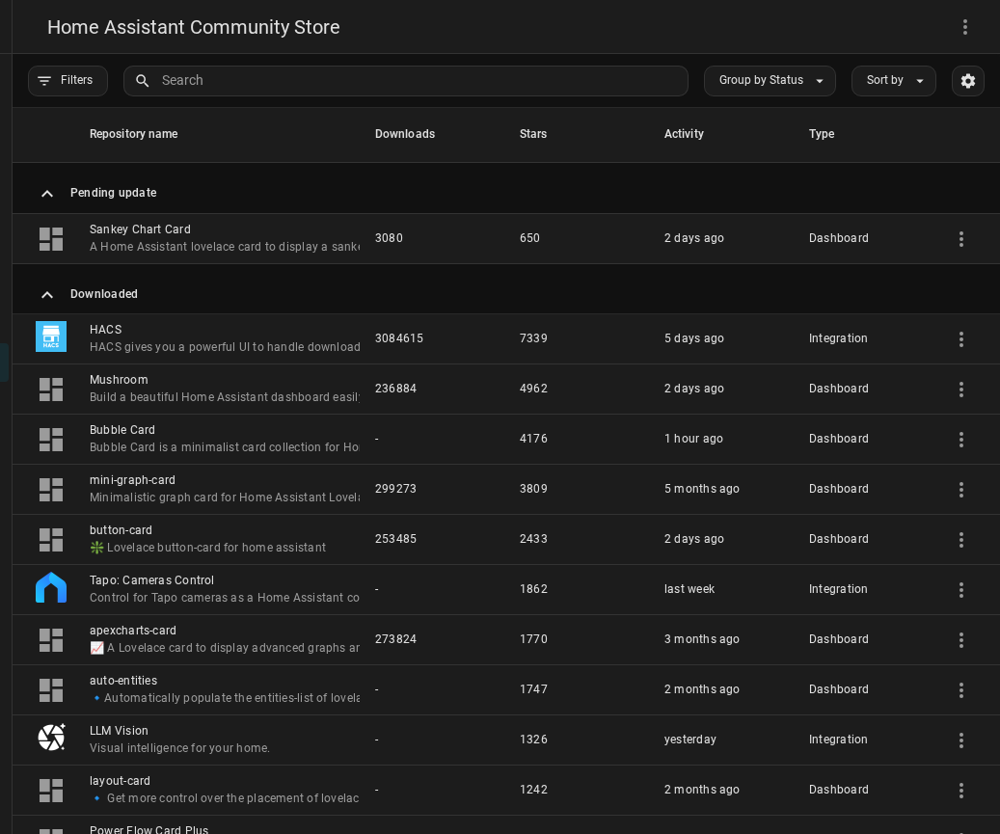
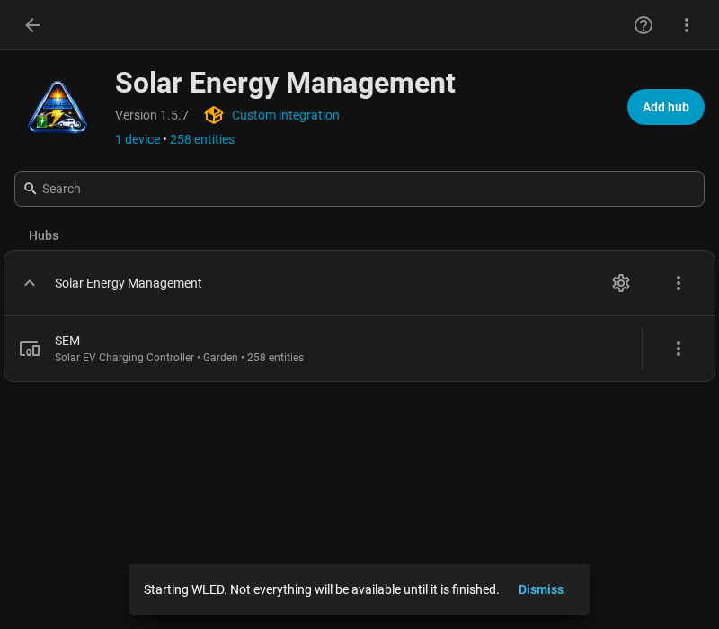
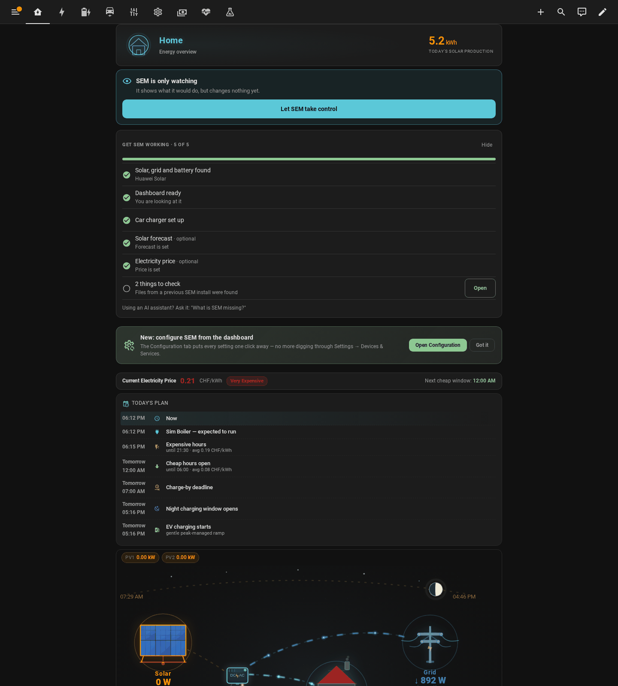

  

# Quick Start Guide

Get Solar Energy Management (SEM) running in your Home Assistant in about 10 minutes.

> **SEM starts by only watching.** After install, SEM sends no commands to your hardware. It shows what it would do. When the dashboard looks right, turn off **`switch.sem_observer_mode`** (watch-only mode). Until then, SEM changes nothing. Step 6 tells you how.

---

## Prerequisites

**1. Home Assistant 2026.8 or newer**

Check your version under **Settings > System > About**. On an older version, update Home Assistant first. HACS offers no new SEM releases for it.

**2. HACS, or Marketplace on Home Assistant 2026.11+**

SEM is distributed through HACS. If you have not installed HACS, follow the [HACS installation guide](https://hacs.xyz/docs/use/download/download/) first. On Home Assistant 2026.11 or newer, HACS is built in as **Settings → Marketplace**, so there is nothing to install.

**3. Solar and grid sensors (power, in watts)**

SEM needs a solar production sensor and a grid sensor. It reads them from the Energy Dashboard if that is set up. If not, it asks the energy integrations you run and offers the sensors it finds. The Energy Dashboard is **not required**.

**4. No EV charger? That is fine**

The charger is optional. SEM works as a monitoring and battery management system without one.

No extra dashboard cards are needed. Every card SEM uses is included.

---

## Step 1: Install SEM

1. Open **HACS** in the Home Assistant sidebar.
2. Go to **Integrations**.
3. Search for **Solar Energy Management** (SEM is in the default HACS store — no
   custom repository needed) and click **Download**.

On Home Assistant 2026.11 or newer, open **Settings > Marketplace** instead of HACS. The other steps are the same.

## Step 2: Restart Home Assistant

Go to **Settings > System > Restart** and wait 30–60 seconds for it to come back.

## Step 3: Add the Integration and Confirm the Sensors

1. Go to **Settings > Devices & Services > + Add Integration**.
2. Search for **Solar Energy Management** and select it.
3. **Confirm the sensors SEM found.** It shows the solar, grid and battery power, in watts.
   - They match your inverter or app: press **Submit**.
   - One is wrong: open **Choose sensors myself**, pick the right sensor, press **Submit**.
   - SEM may ask one question about your grid meter ("buying or sending right now?"). Answer it, or choose **I don't know**. Nothing breaks if you skip it.
4. **Hardware:** set your battery capacity (default 10 kWh) and keep **Generate dashboard** on. Press **Submit**.

**What you should see:** A success message and the integration listed under **Devices & Services**.

Details and screenshots: [Step 1](SETUP_GUIDE.md#step-1-sem-found-your-system), [the grid question](SETUP_GUIDE.md#when-sem-asks-one-more-question). Wrong sensor later: [Sensor source overrides](SETUP_GUIDE.md#sensor-source-overrides).

## Step 4: Open the Dashboard

Click **Solar Energy Management** in the Home Assistant sidebar.

The dashboard has 8 tabs:

| Tab | What it shows |
|-----|---------------|
| **Home** | Live power flow diagram, solar summary, status chips |
| **Energy** | Daily and historical energy flows and self-consumption |
| **Battery** | Battery state, charge/discharge charts, SOC trends |
| **EV** | EV charging session, daily progress, charging history |
| **Control** | All switches, sliders, and device priority settings |
| **Configuration** | Guided access to every SEM setting, with per-row help and docs links |
| **Costs** | Financial breakdown — savings, feed-in revenue, costs |
| **System** | Integration health, sensor status, coordinator info |

**What you should see:** Live power values on the Home tab. If the dashboard looks blank, hard-refresh your browser (**Ctrl+Shift+R**, or **Cmd+Shift+R** on Mac).

Optional extras: `sankey-chart` and `k-flow-card` (HACS > Frontend) add richer views. See [DASHBOARD_GUIDE.md](DASHBOARD_GUIDE.md).

## Step 5: Add Your EV Charger (Optional)

The charger is **not** in the setup wizard. Add it after install:

- Open the **Configuration** tab, or
- Go to **Settings > Devices & Services > Solar Energy Management > Configure**.

SEM pre-fills a charger from what its integration offers (buttons, a charge-mode select, the car's own charging amps). You confirm the values. A field it cannot fill stays empty.

Supported chargers and what each field means: [Setup Guide, EV charger](SETUP_GUIDE.md#step-2-ev-charger-optional).

## Step 6: Optional Forecast and Tariff, then Turn Watch-Only Off

**Solar forecast (optional).** Add one of Solcast, Forecast.Solar, Open-Meteo Solar Forecast or Helios Forecast. SEM then plans around tomorrow's sun: on a sunny day it charges less from the grid.

**Dynamic tariff (optional).** Add Tibber, Nordpool, ENTSO-e or aWATTar. SEM can then charge in the cheapest hours.

**When the dashboard looks right, turn watch-only off:**

1. Check the Home and EV tabs. Do the would-decisions look right?
2. Turn off **`switch.sem_observer_mode`**. Find it in **Settings > Entities** by searching for `sem_observer_mode`.

Until you do this, SEM changes nothing. Once it is off, SEM sends commands to your charger and battery.

Watch-only details: [Setup Guide, watch-only mode](SETUP_GUIDE.md#watch-only-mode).

## Step 7: Where Problems Show

Problems appear in **Settings > Repairs**. Use the **System** tab on the dashboard for sensor health and diagnostics. Before you file an issue, run the `solar_energy_management.diagnose` action and paste its result.

---

## What SEM Does Once It Controls Hardware

- **Solar surplus appears** — EV charging current increases automatically to use it (6–32 A range)
- **Clouds roll in** — EV charging reduces or pauses, resumes when surplus returns
- **Battery reaches priority SOC** — surplus is redirected to EV charging
- **Evening** — solar charging stops; system monitors overnight. With a charger in **Solar + battery**, the home battery keeps the car going after sunset — down to the level the house needs for the night, no further
- **Night charging** — *opt-in (off by default)*; when enabled, grid-charges the EV to your daily-target floor
- **Smart forecast** — if tomorrow is sunny, tonight's grid charging is reduced or skipped
- **The battery's overnight floor is measured** (2.1) — SEM learns what your house uses at night and spends only what tonight can spare
- **The pack fills across the day** (2.1) — charge pacing follows the forecast so the battery lands full at sunset, not by 11:30
- **The 15-minute peak is guarded** (2.1) — on a demand tariff SEM keeps every slot's average under your limit, across all devices
- **Sessions are kept** (2.2) — every finished charge, per charger, on the EV tab with a CSV button. The energy is the charger's own meter
- **PV health** (2.2) — one tile on the Energy tab says green, yellow, orange or red from a week of yield against forecast

The controls that matter most:

| Entity | Default | Purpose |
|--------|---------|---------|
| `select.sem_charger_<id>_charge_mode` | `Min + Solar` | Per-charger charging mode: **Solar only** / **Solar + battery** (surplus plus the home battery, down to the level the house still needs overnight) / **Solar + cheapest hours** / **Min + Solar** (grid minimum 6A + surplus) / **Always max** / **Off** (hands-off — SEM sends nothing). Pick based on your needs; see [Charging Modes](SETUP_GUIDE.md#8-ev-charging-modes) in the Setup Guide. |
| `number.sem_battery_assist_min_surplus` | 1200 W | **Solar Gate**: minimum real solar surplus to enable battery assist for the EV. Set to 0 W to allow battery support everywhere (previous behaviour). Prevents battery drain into the car at night. |
| `switch.sem_observer_mode` | **ON** (new installs) | Watch-only — SEM shows what it would do and sends no commands. Turn it OFF to let SEM control hardware |
| `select.sem_hints` | `off` | Hints (2.2): a sentence when something is off, and a weekly note. **Weekly note** or **All hints** to turn on |

Everything else is automatic.

---

## Language Support

SEM supports 16 languages. The integration follows your Home Assistant language setting automatically. Each user sees the dashboard in their own profile language.

For details, see the [Dashboard Guide](DASHBOARD_GUIDE.md).

---

## Troubleshooting

**The dashboard is blank or shows white tabs**

Usually a stale browser/service-worker cache after an update — hard-refresh (Ctrl+Shift+R), or clear the Companion app's frontend cache.

**Some tabs show an error card**

If the error names a `sem-*` element, SEM's card bundle didn't register — restart Home Assistant and hard-refresh. If it names another custom card, you removed an optional card the dashboard was generated with — re-run the *generate dashboard* action to regenerate with fallbacks.

**Sensors show `unavailable`**

Go to **Settings > Dashboards > Energy** and confirm your solar and grid sensors are configured and currently reporting values. Then open the SEM **System tab** and look for any red indicators.

**The sidebar entry does not appear after install**

Reload the browser first. If it is still missing, restart Home Assistant once. The sidebar entry is registered when SEM starts.

**I set the wrong sensor**

Open **Settings > Devices & Services > Solar Energy Management > Configure** and pick the right sensor. See [Sensor source overrides](SETUP_GUIDE.md#sensor-source-overrides).

---

## Next Steps

- [Setup Guide](SETUP_GUIDE.md) — detailed configuration for EV charging strategy, tariffs, notifications, and multi-charger setups
- [Dashboard Guide](DASHBOARD_GUIDE.md) — all 8 tabs explained, language support, customization options
