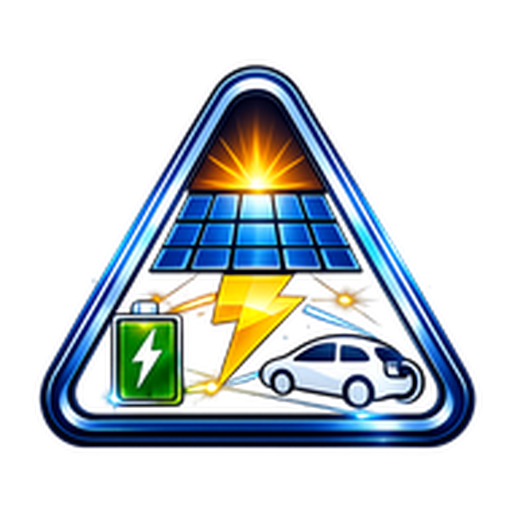
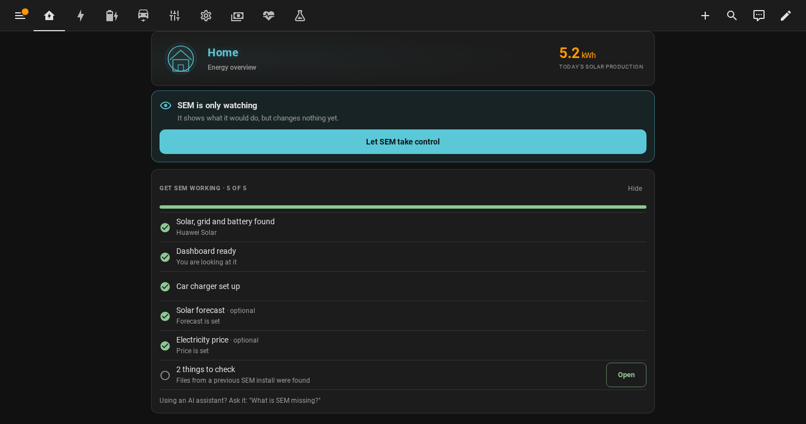

  

# Quick Start

Set up SEM in about 10 minutes. You need Home Assistant 2026.8 or newer.

> On new installs SEM starts in **watch-only mode**. It shows what it would do and sends no commands. It changes nothing until you turn watch-only mode off (step 10).

## Before you start

- **Home Assistant 2026.8** or newer. Check it in **Settings › System › About**.
- **HACS**. On Home Assistant 2026.11 or newer, use **Settings › Marketplace** instead.
- **Two power sensors in watts:** solar and grid. The Energy Dashboard is optional. If it is not set up, SEM asks you for the sensors.
- Optional: an EV charger, a home battery, a solar forecast and a dynamic price.

## Steps

1. **Install SEM.** In HACS, open **Integrations**, search for **Solar Energy Management** and select **Download**.

   

2. **Restart Home Assistant.** Go to **Settings › System › Restart**. Wait 30–60 seconds.

3. **Add the integration.** Go to **Settings › Devices & services › Add integration**. Search for **Solar Energy Management** and select it.

4. **Check the sensors.** SEM shows solar, grid and battery power in watts.
   - If they are right, press **Submit**.
   - If one is wrong, open **Choose sensors myself**, pick the right sensor and press **Submit**.
   - SEM may ask one question about the grid meter. Choose **I don't know** if you are not sure.

   Details: [Setup Guide, step 1](SETUP_GUIDE.md#step-1-sem-found-your-system).

5. **Generate the dashboard.** On the last step, leave **Generate the SEM dashboard now** on, and press **Submit**. SEM restarts Home Assistant once.

6. **Open SEM.** Select **SEM-dashboard** (older installs: **Solar Energy Management**) in the sidebar. The **Now** screen shows what SEM sees and a checklist of what is left.

   

7. **Add your EV charger (optional).** The charger is **not** in the setup wizard. When the checklist says SEM found your charger, press **Use it**. Or go to **System › Chargers › Add charger**. Details: [EV chargers](SETUP_GUIDE.md#7-ev-chargers).

8. **Add the optional extras.**
   - **Solar forecast:** Solcast, Forecast.Solar, Open-Meteo or Helios. SEM then plans grid charging around tomorrow's sun. See [Solar forecast](SETUP_GUIDE.md#11-solar-forecast).
   - **Dynamic price:** a price sensor such as Tibber or Nordpool. SEM then charges in the cheapest hours. See [Tariff and prices](SETUP_GUIDE.md#10-tariff-and-prices).

9. **Check the screens.** Look at **Plan**, **Devices**, **Insights** and **System**. Check that the numbers match your meter or energy app. See [Check the setup](SETUP_GUIDE.md#4-check-the-setup).

10. **Let SEM take control.** On the **Now** screen, press **Let SEM take control**, then **Yes, take control**. You can also turn off the **Watch only** row on **System › Health**, or turn off `switch.sem_observer_mode`. Until you do this, SEM changes nothing.

## Where problems show

- **Settings › System › Repairs** lists problems that need your action.
- **System › Health** shows whether each sensor is fresh.
- Before you report a problem, run the action `solar_energy_management.diagnose` in **Developer tools › Actions**. Paste its result in the report.

## Next

- [Setup Guide](SETUP_GUIDE.md): every step in detail, and where each setting lives.
- [Troubleshooting](TROUBLESHOOTING.md): common problems and their fixes.
