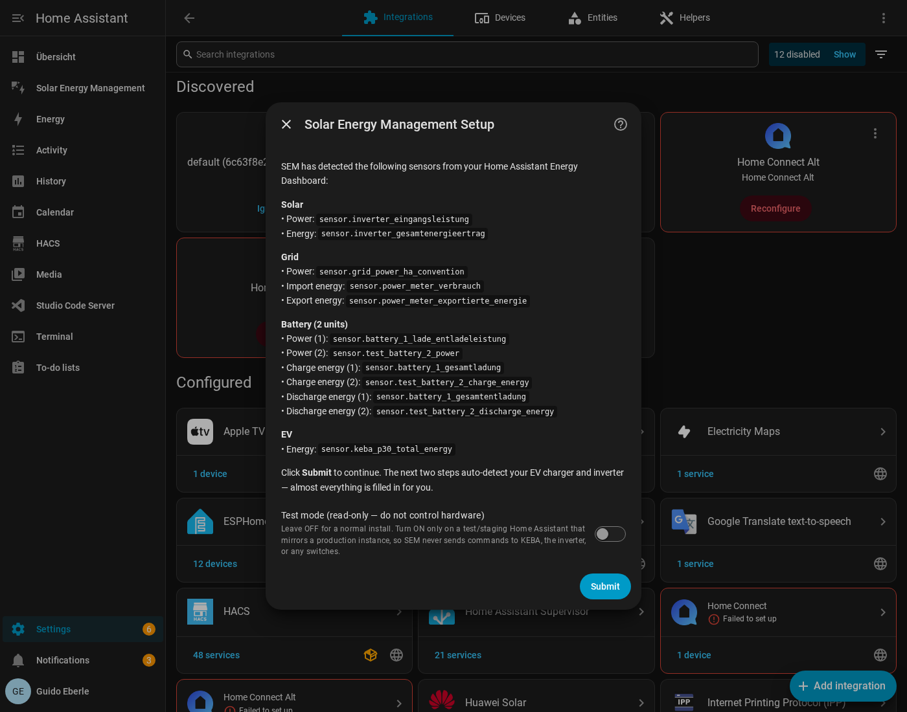

# SEM Setup Guide

This guide covers each setup step, and where each setting lives after setup.
For the short version, see the [Quick Start](QUICK_START.md).

- [Dashboard screens and settings](DASHBOARD_GUIDE.md)
- [Multi-inverter and multi-charger setups](MULTI_DEVICE_GUIDE.md)
- [Troubleshooting](TROUBLESHOOTING.md)

---

## 1. Requirements

- **Home Assistant 2026.8.0** or newer. Check it in **Settings › System › About**.
- **HACS**, or **Settings › Marketplace** on Home Assistant 2026.11 or newer.
- **Solar and grid power sensors** in watts. Not daily totals.
- **Energy Dashboard: optional.** SEM reads it when it is set up. If it is not, SEM asks you for the sensors.
- Optional: a home battery, an EV charger that Home Assistant can control, a solar forecast, a dynamic price.
- Check [Supported hardware](SUPPORTED_HARDWARE.md) for your brand before you install.

**Solar forecasts (optional):** Solcast, Forecast.Solar, Open-Meteo or Helios. A forecast lets SEM plan around tomorrow's sun. SEM installs without one.

No extra dashboard cards are needed. SEM's cards are part of the integration.

## 2. Install

1. In HACS, search for **Solar Energy Management** and select **Download**. On Home Assistant 2026.11 or newer, open **Settings › Marketplace**.
2. Restart Home Assistant. Wait 30–60 seconds.
3. Go to **Settings › Devices & services › Add integration** and continue with step 3 below.

To test beta versions, open the SEM entry in HACS, select **Redownload**, and turn on **Show beta versions**.

## 3. Config flow

The setup flow asks for your sensors, then one final choice. Most homes see two screens.

### Step 1: SEM found your system



This screen shows what SEM reads from the Energy Dashboard, in watts: **Solar power**, **Grid power** and **Battery power** with its charge.

1. Check the three values against your inverter or energy app.
2. If they are right, press **Submit**.
3. If one is wrong, open **Choose sensors myself**, pick the right sensor and press **Submit**. Only the sensors you change are saved.

An empty line means SEM found several sensors that could fit, such as one per battery module. SEM does not guess. Pick the sensor for the whole battery, the whole solar array or the whole meter.

### When SEM asks one more question

SEM asks more only when it cannot tell the grid direction, or cannot find a grid sensor.

**The grid direction is unclear.** SEM asks: *What is your house doing right now?*


| Answer | Choose it when |
|---|---|
| **Buying from the grid** | Your house takes power from the grid. |
| **Sending to the grid** | Your house gives power to the grid. |
| **This is my grid meter** | The meter reads almost 0 W, so it cannot tell. |
| **Use the other meter** | Shown only when SEM found a second meter. |
| **I don't know** | You cannot tell. SEM learns the direction over the next days. |

**No grid power sensor was found.** Pick your grid power sensor. Use a sensor in W or kW, not a kWh counter. Or press **Submit** and set it later under [Sensor source overrides](#sensor-source-overrides).


### Without the Energy Dashboard

If the Energy Dashboard is empty or has no solar or grid sensor, SEM shows **Name your energy sensors**. SEM proposes the sensors your installed integrations offer. You confirm them.

| Field | Required | Notes |
|---|---|---|
| **Solar power** | Yes | Live production in watts. |
| **Grid power** | Yes, or the pair below | One signed sensor: SEM works out which way it runs. |
| **Grid import power (optional)** and **Grid export power (optional)** | Only if there is no grid power sensor | Two positive sensors. Fill both, or neither. |
| **Battery power (optional)** | No | Live charge and discharge in watts. |
| **Battery charge % (optional)** | No | State of charge. SEM's battery zones read it. |
| **Observer mode (watch only, command nothing)** | On by default | SEM sends no commands. |

### Hardware

The last screen has one option: **Generate the SEM dashboard now**, on by default. SEM creates the dashboard, then restarts Home Assistant once.

Press **Submit**. SEM starts. The EV charger is not part of the flow. Add it later, see [EV chargers](#7-ev-chargers).

### Watch-only mode

New installs start in **watch-only mode**. SEM reads your system, builds the dashboard and shows what it would do. It sends no commands to your hardware.

- While watch-only mode is on, SEM's own settings stay editable. Actions on devices are blocked.
- Turn it off when the decisions look right. Press **Let SEM take control** on the **Now** screen and confirm, or turn off **Watch only** on **System › Health**.

## 4. Check the setup

- **Now** screen: the top banner says whether SEM only watches. The checklist lists what is left.
- **System › Health**: **Setup check** and **Hardware** rows, and the sources. The first line says *All sources OK* or names the source to check.
- **Developer tools › States**: search for `sem_`. Check `sensor.sem_solar_power` (zero at night, positive by day), `sensor.sem_grid_power` and `sensor.sem_battery_power`.
- **Developer tools › Actions**: search for `solar_energy_management`. If nothing appears, the integration did not load. Check the log under **Settings › System › Logs**.

### Sensor source overrides

<a id="sensor-source-overrides"></a>


SEM takes solar, grid and battery power from the Energy Dashboard first. To change one:

1. Open **System**. The top of the sources section shows the live values in watts.
2. If a direction is wrong, press **Grid direction is wrong** or **Battery direction is wrong**. One tap turns it around.
3. If a sensor is wrong, pick another under **All settings**. Pick the meter's own sensor, not one of SEM's `sensor.sem_…` entities.

If an override goes unavailable, SEM keeps reading it and shows a warning on that row. It does not fall back silently.

## 5. Settings: where they live

After setup, change settings on the dashboard, not in the integration's options.

- Open **System**. Settings are grouped by topic. Each row shows its value on the right.
- Tap a row to change it. A dialog opens.
- Switch rows change on the row itself.
- **All settings** shows every row in one list.
- On **System**, changes apply together when you press **Apply** at the bottom.
- On **Devices**, rows apply at once.
- SEM asks first before a change that alters behaviour, such as flipping a sign, pausing charging or selling battery energy.

| System group | What it holds |
|---|---|
| **Health** | Setup check, hardware, source freshness, watch-only switch. |
| **How I pay** | Tariff mode, import and export rates, price sensors, taxes and fees. |
| **What SEM may do** | Peak limit, load management, AC limit, export guard, virtual power plant. |
| **Battery rules** | Battery levels (read only, change them on **Devices**), discharge limit, battery wiring, charge scheduler. |
| **Chargers** | Each charger's charge mode, targets and sensors. Add or remove a charger. |
| **Heat pump and hot water** | SG-Ready contacts, boiler control, temperatures. |
| **What SEM reads** | Sensors SEM uses for solar, grid, battery and the house. |
| **Notifications and more** | Notifications, hints, vacation mode, update interval, other options. |

Option keys for the settings above, for automations and `set_option`:

| Row | Option key |
|---|---|
| Watch only | `observer_mode` |
| Update every | `update_interval` |
| Tariff mode | `tariff_mode` |
| Import rate | `electricity_import_rate` |
| Export rate | `electricity_export_rate` |
| Dynamic price entity | `dynamic_tariff_entity` |
| Feed-in entity | `dynamic_feedin_entity` |
| Classification mode | `tariff_classification_mode` |
| Price basis | `import_price_basis` |
| Feed-in fee | `feed_in_fee_model` |
| Stop exporting below | `export_value_threshold` |
| Solar forecast source | `solar_forecast_source` |
| Below this the battery fills first | `battery_priority_soc` |
| From this the battery may help the car | `battery_buffer_soc` |
| From this it may help fully | `battery_auto_start_soc` |
| Spare sun the battery needs to help the car | `battery_assist_min_surplus` |
| May the battery help charge the car? | `battery_may_assist_ev` |
| May the battery sell to the grid? | `battery_may_export` |
| Minimum solar power | `min_solar_power` |
| Legionella temperature | `legionella_target_temp` |
| Legionella interval | `legionella_interval_hours` |
| Hot water solar target | `hot_water_solar_target` |

## 6. Devices

Open **Devices** to see the battery, cars, heat pumps, tanks and other loads. Each row has its own settings.

**Mode** decides what SEM does with a load:

| Mode | What SEM does |
|---|---|
| **Off** | Never touches the device. |
| **Peak only** | Pauses the device at a grid peak. Your own automation runs it. |
| **SEM runs it** | Starts and stops the device on solar surplus. |
| **SEM runs it, battery may help** | As above, and by day the house battery may help. |

A new device starts in **Off**. Drag rows to change the priority. Priority decides which device gets surplus first.

### Add a device

1. Open **Devices** and press **Add a device**.
2. Enter a **Name**.
3. Choose a **Switch SEM turns on and off**, or choose **Measured, without a switch** if SEM can only read its power.
4. Optional: add a **Power sensor** and the **Power when on, W**.
5. Press **Add**.

Devices that Home Assistant's Energy settings measure under **Individual devices** appear here by themselves.

A device with its own meter and price has a **Device tariff** row.

## 7. EV chargers

The EV charger is not part of the setup flow. Add it after setup:

- **System › Chargers › Add charger**, or
- Press **Use it** on the **Now** checklist, when SEM found a charger.

SEM fills in what your charger's integration offers. Check each value. A field SEM cannot fill stays empty.

| Field | What it is |
|---|---|
| **Connected sensor** | Reports that the car is plugged in. |
| **Power sensor** | Charging power in watts. |
| **Control** | A number entity for the current, a start and stop entity, or a service call. |
| **Current sensor** | Optional. Amps the car draws. |
| **Total energy sensor** | Optional. Lifetime kWh of the charger. |

Some fields are set only in **Settings › Devices & services › SEM › Configure**: `ev_charger_service`, `ev_charger_service_entity_id`, `ev_charging_sensor`, `ev_current_sensor`, `ev_total_energy_sensor` and `vehicle_range_entity`.

### Charge modes

Each charger has a **Charge mode**. The default is **Min + Solar**.

| Charge mode | What it does |
|---|---|
| **Solar only** | Charges from solar surplus. Never from the grid, unless **At least** is set. |
| **Solar + battery** | Solar surplus first. Then the house battery, down to what the house needs for the night. |
| **Solar + cheapest hours** | Solar surplus, plus the grid in cheap hours. Needs cheaper hours: a dynamic, schedule or two-rate tariff. |
| **Min + Solar** | The grid fills up to **At least** by the **Charge by** time. Solar adds up to **Up to**. |
| **Always (max)** | Charges at the maximum, from the grid and the battery. |
| **Off** | SEM sends no commands to the charger. |

### Charge target

- **At least** is the amount SEM guarantees by the charge-by time.
- **Up to** is the most that solar may add.
- The target is kWh, or a percentage if the car reports its state of charge.
- **Charge by** is the time the car must be ready.

## 8. Battery

### Battery rules

On the battery card on **Devices**, set the levels. **System › Battery rules** shows them read only, with a link there.

| Row | What it does |
|---|---|
| **Below this the battery fills first** | Priority level (default 30 %). All spare sun goes to the battery. The car waits. |
| **From this the battery may help the car** | Below it the battery stays for the house. |
| **From this it may help fully** | Auto-start level (default 90 %). Still only with enough spare sun. |
| **Spare sun the battery needs to help the car** | Solar Gate (default 1200 W). Shown only while **May the battery help charge the car?** is on. |

Set **May the battery help charge the car?** and **May the battery sell to the grid?** on the same card.

Each battery has a mode: **Auto**, **Self-consumption only**, **Force charge**, **Force discharge**, or **Off (hands-off)**. With **Off**, the inverter manages the battery on its own.

### Battery charge scheduler

The scheduler charges the battery from the grid in cheap hours, before a day with little sun. It runs only when the price makes it pay: the charge must cost less than the power it replaces, after losses.

It needs price data and a battery that SEM can charge from the grid. Without a solar forecast, SEM counts solar as 0.

### Battery charged by its operating mode or backup reserve

Some batteries have no single **charge from the grid** switch. For these, SEM sets up to three entities and puts the old values back when the charge stops:

| Field | What to set |
|---|---|
| **Grid-charge select** | The select that changes how the battery runs. |
| **Option that charges from the grid** | The option in that select that charges. |
| **Charge target level entity** | A number that holds the level to charge to, such as a backup reserve. |
| **Charge switch** | A switch that must be on for a grid charge, such as "allow grid charging". |

With the select and option set, SEM charges through them. Some inverters have only the select. The charge target and the charge switch show only with one battery, because two packs cannot share one stop.

Tesla Powerwall example: the select is the operating mode, the target is the backup reserve, and the switch is "allow grid charging". Each value is saved before SEM changes it. If Home Assistant stops during a charge, SEM puts the values back when it starts again.

### Battery held through a mode select

Some inverters have no number that limits discharge, only a mode select. One option stops the battery giving, and the house runs from the grid.

| Field | What to set |
|---|---|
| **Discharge-hold select** | The mode select. |
| **Option that stops discharge** | The option that keeps the battery, such as `Utility`. |

Turn on **House as a battery sink**. SEM then keeps the battery in cheap hours for the dear hours that follow, and puts the select back after. A hand change is left alone. SEM writes the select at most 12 times a day and checks that the hold works.

Some inverters charge from the grid only in this mode. So a grid charge also sets the hold option, and the next normal cycle puts the mode back.

## 9. Heat pump and hot water

### What is SG-Ready?

SG-Ready is a German standard for heat pumps. Two relay contacts give the pump four states:

| State | Contact 1 | Contact 2 | What the heat pump does |
|---|---|---|---|
| 1 — Blocked | On | Off | Uses less power on a utility block. |
| 2 — Normal | Off | Off | Normal operation. |
| 3 — Boost | Off | On | Heats more now. |
| 4 — Force on | On | On | Uses as much power as it can. |

This is not a 2-bit count. State 1 is `1:0`, and state 2 is `0:0`. Do not read the states as binary numbers.

SEM sets Boost when there is moderate spare sun, and Force on when there is a lot. If the pump does the opposite, turn on the invert option in the heat pump's settings. Do not swap the contacts.

### Contacts

- **SG-Ready contact 1** and **SG-Ready contact 2**: the switch, or another entity that holds a value (`text.`, `number.`, `select.`, or an `input_` helper).
- For a contact that holds a value, set **Contact 1 — ON value** and **Contact 1 — OFF value**. SEM writes these values as they are. Set the same for contact 2.
- Some pumps take a service call instead. Set the service and its JSON data. The data can use `{state}`, `{relay1}` and `{relay2}`. If you set a service, SEM does not touch the contacts.
- Optional: a **Climate entity**, to raise the setpoint when there is spare sun, and a **Power sensor**.

### Hot water boiler

Set up the boiler on **System › Heat pump and hot water**: the **Boiler control entity**, an optional **Temperature sensor**, and the **Hot water solar target**.

Then open the boiler's row on **Devices**. It asks four questions:

| Question | Row |
|---|---|
| Which temperature SEM keeps? | **Keep it at** |
| Below which temperature SEM heats at once, at any price? | **Never colder than** |
| How hot may free sun heat it? | **With spare sun, heat up to** |
| May SEM buy power for it? | **May SEM buy power for it?** (No, sun only, or Yes, in cheap hours) |

For the legionella cycle, set **Legionella temperature**. Set **Legionella interval** to the most hours allowed between two cycles.

## 10. Tariff and prices

Open **How I pay** on **System**.

| Row | Choices or meaning |
|---|---|
| **Tariff mode** | **fixed**: one import and export rate. **dynamic**: an hourly price sensor. **by schedule**: a Schedule helper with peak hours. |
| **Import rate**, **Export rate** | Your prices per kWh. Used for costs and savings. |
| **Dynamic price entity** | A sensor whose state is the current price per kWh. |
| **Feed-in entity** | A sensor with the export price. Optional. |
| **Classification mode** | **by price range** (default): cheap and expensive are relative to today's prices. **fixed thresholds**: your own cheap and expensive limits. |
| **Price basis** | **All-in**: the price already has taxes. **Spot incl. VAT** or **Spot**: SEM adds markup, tax and VAT. |
| **Taxes and fees preset** | **None**, **Netherlands from 2027**, or **Custom**. |
| **Feed-in fee** | **None**, **Per kWh**, **Tiered** or **Fixed monthly**. |

Any price sensor works if its state is the current price per kWh. For a day-ahead curve, the sensor can also expose `raw_today` and `raw_tomorrow`. SEM reads them to find the cheap hours.

Tiered tariffs, such as Spain's 2.0TD or US time-of-use, are covered in [Tariff models](TARIFF_MODELS.md).

## 11. Solar forecast

Open **What SEM reads** on **System** and set **Solar forecast source**.

- **Auto-detect** uses the first one installed, in this order: Solcast, Forecast.Solar, Open-Meteo, Helios.
- Or pick one of the four. SEM then uses that one, and falls back to auto-detect only if it is no longer installed.

SEM reads these four forecast integrations only. A forecast integration that is not on this list is not supported yet.

## 12. Load management

Load management sits on **System**. It keeps the house under your grid peak limit by pausing devices in **Peak only** or **SEM runs it** mode.

If your grid operator switches devices off by a signal, connect that signal as the **Grid operator relay** sensor. For a device that the operator's relay switches itself, turn on **Behind the grid operator's relay** in that device's settings. SEM then does not plan that device.

## 13. Language

SEM follows the language in each user's Home Assistant profile. SEM has 16 languages. To change yours, open your profile in the sidebar and select **Language**.

## 14. Problems and questions

**My sensors show unavailable.** Check that the inverter is online and that the sensors in **Settings › Dashboards › Energy** report values. Then check **System › Health**.

**A device turned off by itself.** Check its mode on **Devices**. A device in **Peak only** is paused at a grid peak. **Why now** on **Now** says what changed and why.

**SEM sent a command to a device you do not want it to control.** Set that device's mode to **Off**. SEM then sends it nothing.

**Two Home Assistant instances.** Turn on watch-only mode on the second instance. Then only one instance sends commands.

**My car is connected but not charging.** The **Now** screen and the **Plan** screen say why. For example, the battery may be below its priority level, or the car may already be at its target.

**SEM uses too much CPU.** Raise **Update every** under **Notifications and more**. The default is 10 seconds.

**Debug logging.** Add this to `configuration.yaml`, restart, and look under **Settings › System › Logs**:

```yaml
logger:
  logs:
    custom_components.solar_energy_management: debug
```

## 15. Remove SEM

1. Go to **Settings › Devices & services › Solar Energy Management**.
2. Open the three-dot menu and select **Delete**.
3. Restart Home Assistant.
4. In HACS, open **Integrations**, find SEM and select **Remove**. If you installed it by hand, delete the `custom_components/solar_energy_management/` folder.

SEM's entities are removed. Your Energy Dashboard and hardware sensors are not changed.
