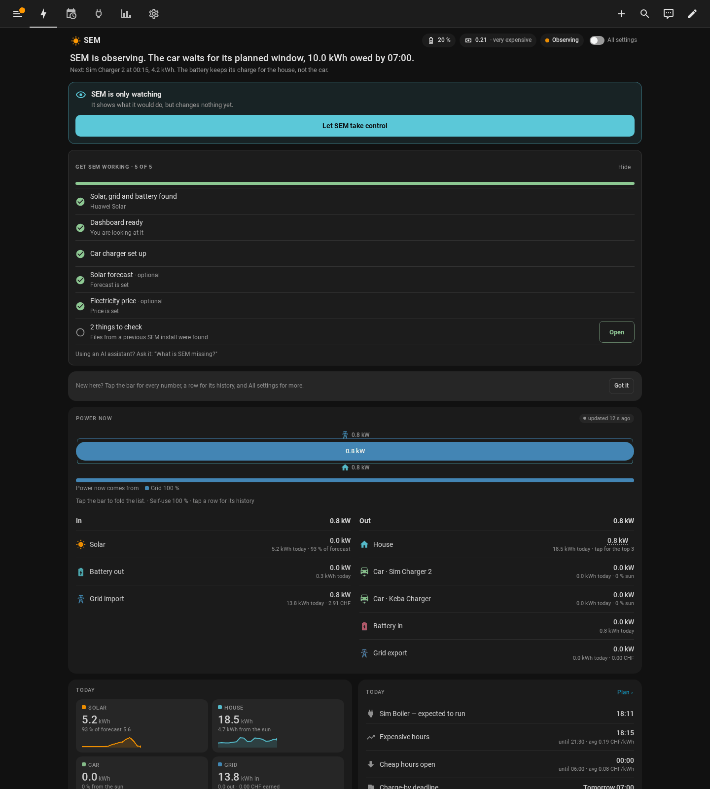

# Troubleshooting

Find what you see, then check the steps in order.

Screens: **Now**, **Plan**, **Devices**, **Insights**, **System**. A setting is a row: tap it to change it. Rows that the everyday view hides are under **All settings** (top right).

Paths below read like `System › Battery rules`, or name the card on **Devices**.



## First checks

1. **Watch only.** If the **Watch only** chip shows on **Now**, SEM sends no commands to your devices. Turn it off in `System › Health › Watch only`.
2. **Repairs.** Open `Settings › System › Repairs`. A notice names the problem. The [Repairs](#repairs) list says what each one means.
3. **Copy diagnostics.** If you ask for help, include the copied text. See [Copy diagnostics and Diagnose](#copy-diagnostics-and-diagnose).

## Contents

- [Dashboard](#dashboard)
- [Setup and sensors](#setup-and-sensors)
- [Values look wrong](#values-look-wrong)
- [Car charging](#car-charging)
- [Battery and loads](#battery-and-loads)
- [Hot water and heat pump](#hot-water-and-heat-pump)
- [Watch only and two controllers](#watch-only-and-two-controllers)
- [Settings](#settings)
- [Repairs](#repairs)
- [Copy diagnostics and Diagnose](#copy-diagnostics-and-diagnose)

## Dashboard

### The dashboard shows a red card or "Configuration Error"

**Check:** Is Home Assistant in YAML mode for dashboards? SEM cannot add its cards there.

**Fix:**
1. Go to `Settings › Dashboards`. Use ⋮ › **Take control** on the SEM dashboard.
2. Restart Home Assistant.
3. Hard-refresh the browser (Ctrl+Shift+R).
4. In YAML mode, add the card files by hand. See [Lovelace is in YAML mode](#lovelace-is-in-yaml-mode).

### A card is blank or says "Custom element doesn't exist"

**Check:** The browser may still hold old files.

**Fix:**
1. Hard-refresh the browser (Ctrl+Shift+R). On the phone app, clear the app cache.
2. If the card is blank with no error, check `System › Health`. It lists the sources that are unavailable.
3. A card you placed by hand from the old dashboard shows a **retired** note with a link to the new screen. Replace it with the new screen.

### The SEM dashboard is missing

**Fix:**
1. Go to `Developer tools › Actions` and run **Generate SEM Dashboard** (`solar_energy_management.generate_dashboard`).
2. Hard-refresh the browser.

### Lovelace is in YAML mode

**Symptom:** The Repair **Lovelace is in YAML mode** appears. The SEM dashboard is blank or shows red cards.

**Fix:** Add the two card files under `lovelace: resources:` in `configuration.yaml`. Use `type: module` for each:

```yaml
lovelace:
  mode: yaml
  resources:
    - url: /local/custom_components/solar_energy_management/dashboard/card/dist/sem-cards.js
      type: module
    - url: /local/custom_components/solar_energy_management/dashboard/card/sem-localize.js
      type: module
```

Restart Home Assistant. Then hard-refresh the browser.

## Setup and sensors

### A configured sensor is unavailable

**Check:** `System › Health` lists the source. Open the sensor in `Developer tools › States`.

**Fix:**
1. Fix the sensor at its source: the inverter integration, the cloud service or the network.
2. The Repair clears when the sensor reports a value again.

### A sensor stopped updating (stale)

**Check:** The sensor shows a number but the value does not change.

**Fix:** Check the integration that feeds it. The Repair clears when the sensor updates again.

### SEM found no power sensor

**Symptom:** The Repair **No power sensor for …** appears. A solar or battery energy counter has no power sensor, so SEM reads that power as 0 W.

**Fix:**
1. Add a power sensor (W or kW) to that entry in `Settings › Dashboards › Energy`.
2. Or set it in `System › What SEM reads`: **Grid power**, **Solar power sensor** or **Battery power sensor**.
3. If the device has no power sensor at all, ignore the Repair.

### SEM does not see your grid export

**Cause:** Only **Grid import sensor** is set. SEM reads export as 0 W.

**Fix:**
1. In `System › What SEM reads`, set **Grid export sensor**.
2. Or clear **Grid import sensor**. SEM then looks for the import and export pair.

### SEM does not see all your solar or battery power

**Cause:** Two inverters or batteries, and the power sensor covers only one. SEM does not take a second power sensor from a device it already reads.

**Fix:** Add a power sensor for the other entry in the Energy Dashboard.

### No solar forecast integration found

**Fix:** Install a forecast integration (Forecast.Solar, Solcast PV Solar) or a forecast sensor. Forecast features stay off until you do.

### The recorder is not available

**Cause:** SEM could not read its history from the recorder. This is usually a one-off.

**Fix:** Check that the recorder is on. The Repair clears on the next good read.

### Files from a previous SEM install

**Fix:** SEM removed its own old files. Your history and old dashboard are still there. To delete them too, run **Remove leftovers** (`Developer tools › Actions`). Otherwise ignore the Repair.

## Values look wrong

### Grid import and export are swapped

**Check:** The Energy Dashboard has both the grid import and the grid export counters.

**Fix:**
1. Go to `System › What SEM reads › Grid sign`. Tap **flip sign**. SEM asks first.
2. If the sign was learned wrong earlier, open `What SEM reads › All settings › Reset sign detection`. SEM learns the sign again.

### SEM guessed your grid power meters

**Symptom:** A Repair names two sensors that SEM picked by name. Grid values do not match your meter.

**Fix:** Pick your meter yourself in `System › What SEM reads`:
- One signed sensor for the grid: **Grid power**.
- One sensor for import and one for export: **Grid import sensor** and **Grid export sensor**.

### SEM could not find your grid power meters

**Symptom:** The Repair names two sensors and says they are not your meters. SEM reports no grid power.

**Fix:** Set **Grid power**, or the import and export sensors, as above. If your meter publishes no fast power at all (some cloud services), leave them empty. SEM then reports no grid power.

### Battery charge and discharge are swapped

**Check:** The Energy Dashboard has both the battery charge and the discharge counters.

**Fix:** SEM sets the sign from those counters after a restart. If it is still wrong, tap `System › What SEM reads › Battery sign` and confirm **flip sign**.

### Home is lower than the Energy Dashboard's Home

This is usually correct. The two numbers answer different questions.

| Entity | Includes the car? |
|---|---|
| `sensor.sem_daily_home_energy` | No. The house only. |
| `sensor.sem_daily_total_consumption` | Yes. House and car. Compare this one with the Energy Dashboard. |

If the total matches the Energy Dashboard, nothing is wrong.

### Daily totals do not match your meter

**Check:** Solar, grid and battery counters are in `Settings › Dashboards › Energy`. Home is calculated from them.

**Fix:** Add the missing counter. Daily values reset at midnight, as in the Energy Dashboard.

### The energy flow shows no grid lines

**Cause:** The grid entry in the Energy Dashboard has no power sensor. SEM reads 0 W from the grid. The totals still come from the meter's kWh counters.

**Fix:** Add the meter's power sensor to the grid entry, or set **Grid power** in `System › What SEM reads`. The lines start from then on.

## Car charging

### A charger control entity is broken

**Fix:** Check the entity in `Developer tools › States`. If it is missing or unavailable, fix it at the source. If it is gone for good, pick another under `System › Chargers`.

### The car does not charge

**Check, in order:**
1. **Devices › your charger.** The row says why. For example: "No car is plugged in."
2. **Charge mode.** Off never charges. **Solar only** charges only from spare sun. Spare sun must reach the charger's minimum: about 1380 W for a 1-phase charger at 6 A, about 4140 W for a 3-phase charger at 6 A.
3. **Repairs.** **EV charger not accepting commands** means the charger refuses SEM's commands. **EV charger cannot be stopped** means SEM has no way to stop it.
4. **System › Chargers.** Check the charger's current control: **current control** (an entity) or **via action** (a service).

### The car charges when it should not

**Check:** The **Logbook** in the sidebar has a line for each command with its reason. A line ending in *(observer: not sent)* was not sent.

**Fix:**
- Charge mode **Off**: the charger may restart on its own. Look for [the wallbox undoes SEM's stop](#your-wallbox-undoes-sems-stop-on-a-timer).
- The car charged overnight: its charge mode is **Min + Solar** or **Solar + cheapest hours**, and a target is not reached. To charge from solar only, set **Solar only** and set **At least** to 0.
- The battery charges the car: on **Devices**, open the battery card and turn off **May the battery help charge the car?**.

### Your wallbox undoes SEM's stop on a timer

**Cause:** The wallbox switches itself on again a fixed time after SEM stops it. It uses its own fallback current.

**Fix:** On the wallbox, set the fallback current to 0. SEM does not fight the wallbox.

### SEM stood down while the charger kept charging

**Cause:** The charger restarts each time SEM stops it. Another controller may also be sending commands.

**Fix:** Turn off the wallbox's auto-start, or stop the other controller. SEM does not stop the charger again for a while. It takes control again when the car stops.

### The charger draws on a different number of phases than SEM believes

**Fix:** Set the charger's **Phases** to the number the Repair names. The Repair clears when they match.

### Another party writes to a device

**Symptom:** A setting keeps changing back. A Repair says another party writes to the device.

**Fix:** If the other party should win, set **Steered by another party** to **Yes, SEM yields** in `All settings` for that device. Then pick the entity that shows when the other party is in control. Leave it empty and SEM always yields. If the other party should not control it, stop its program.

### A charger was left off after the phase guard

**Symptom:** A Repair says SEM left a charger off after the phase guard. The charger is steered by another party.

**Fix:** The phase went over its limit each time SEM switched the charger back on. Switch it on yourself, or in the app that steers it, when the house uses less power. Check the phase limit and which big loads share that phase. The Repair goes away when the charger is on again or the car leaves.

### The Plan screen shows nothing

**Check:**
- **No plan yet. SEM makes one when the night window opens.** Wait for the night window.
- **Nothing planned from the grid.** No car or load needs grid power. This is correct when the sun covers the day.

## Battery and loads

### A battery control write is not taken

**Symptom:** SEM sets a battery entity, and the device keeps the old value.

**Fix:** Pick another entity for that role in `System › Battery rules`. If the device holds the value by hand but not for SEM, check the entity's brand.

### Your battery SOC zones are out of order

**Fix:** On the battery card on **Devices**, set **Below this the battery fills first**, **From this the battery may help the car** and **From this it may help fully** to rise in that order. Any values work, as long as they rise.

### The battery platform is pinned to generic

**Symptom:** A brand battery is loaded, but its controls act crudely. A Repair says the platform is Generic.

**Fix:** In **Settings › Devices & services › Solar Energy Management › Configure › Battery Charge Scheduler**, set **Battery charge platform** to **Auto-detect**. Keep **Generic** only if the battery has its own control entities.

### A home without a battery makes no night plan

**Symptom:** No battery, but **Solar + cheapest hours** charges at once.

**Fix:** Update SEM. A battery platform of **Generic** alone no longer counts as a battery.

### The inverter refuses forced discharge

**Fix:** Check that the battery power setpoint entity is the right one. Read the error in the Repair. Restart SEM to try again.

### The battery power setpoint keeps going unavailable

**Fix:** Keep the battery online. Check that the entity has a numeric state and a W or kW unit. Restart SEM to try again.

### The battery is in a mode SEM does not expect

**Symptom:** The inverter's operating mode is not the one SEM plans with.

**Fix:** Set the inverter back to the expected mode. If the other mode is deliberate, dismiss the Repair. SEM does not fight your choice.

### Deye System Work Mode setup cannot be used

**Fix:** In `System › Battery rules`, check the select entity and its three option labels.

### SEM cannot rebuild your battery-night history

**Cause:** A sensor that SEM needs is missing.

**Fix:** Add the missing sensor. Then go to **Devices** and press **Rebuild from history**.

### Rebuilt nights cannot see what the grid contributed

**Fix:** Add the grid counters to the Energy Dashboard. Then press **Rebuild from history** again.

### The grid charge select is still on

**Symptom:** A select stays on a grid charge option. SEM cannot put it back because the old option is gone.

**Fix:** Set the select back by hand. Until you do, the battery may keep charging from the grid.

### A load is set to current control but its entity is in watts

**Fix:** Pick the ampere entity for current control. For a variable load (an AC heater or heat rod), use an on/off switch entity instead.

### The grid peak is driven by a load SEM does not control

**Cause:** Even with every switchable load off, the grid stays above the peak limit.

**Fix:** Lower that load's limit, give SEM the load, or raise **Peak limit level** in `System › What SEM may do`.

### SEM leaves security devices alone

**Cause:** A device has a camera, an alarm panel, a siren or a lock in Home Assistant. SEM never lists or switches such a device. A lock that Home Assistant marks as a setting (a child lock) does not count.

**Fix:** Nothing for a camera, alarm or door lock. Its energy still counts in the home total. If the device is an appliance with a lock, add it with **Add a device**.

### SEM no longer uses old automatically found devices

**Cause:** Older versions found switches by their name and used them as loads. You could not see or set these devices, and the peak limit could switch them off. SEM no longer uses them.

**Fix:** Nothing, if you did not want SEM to control them. To let SEM control one, add it with **Add a device** on **Devices**. It starts at Mode **Off**; turn it on there.

## Hot water and heat pump

### Hot water does not heat

**Check:**
1. `System › Heat pump and hot water` names the hot water entity. It must exist in `Developer tools › States`.
2. On **Devices**, the hot water row is in **SEM runs it** or **SEM runs it, battery may help**. **Off** and **Peak only** do not heat from surplus.
3. The surplus covers the heater's minimum power.
4. The temperature sensor reports a real number.

### The hot water tank draws power but does not warm

**Fix:** Check the heating element and the tank's own thermostat or safety cut-out. Check that the temperature sensor sits in the tank. The Repair clears when a later run warms the tank.

### Legionella cycle not running

**Cause:** The cycle runs when the interval has passed since the water last reached the target.

**Fix:**
1. Check **Stop when** on the boiler. If it is below the Legionella target, SEM skips the run. Raise **Stop when** or lower the target.
1. A Repair says the tank cannot reach the target: the tank accepts less than the Legionella target. SEM heats to the tank's maximum. Lower the target, or check the tank's own maximum.
2. Check the interval under `System › Heat pump and hot water`.
3. Check that the boiler entity is available.

### Heat pump SG-Ready relay unavailable

**Fix:** Fix the relay at its source. The relay can be a switch, a relay board or a template. The Repair clears when the relay reports on or off.

### Heat pump: only one SG-Ready relay

**Fix:** Set the second relay. Or set a climate entity and use the climate-only path.

With only contact 1, SEM keeps it at normal. It never sends "blocked" by mistake, but it cannot boost the pump either.

### Heat pump SG-Ready contact values

**Fix:** Under `System › Heat pump and hot water`, fill both the ON value and the OFF value of the contact. Or use a switch entity instead.

### Hot water switch unavailable

**Fix:** Check the boiler's relay or integration. The Repair clears when the entity recovers.

### Hot water temperature sensor unavailable

**Fix:** Check the sensor's integration. Until the temperature returns, SEM does not heat past its target.

## Watch only and two controllers

### Two Home Assistant instances control the same hardware

**Cause:** A test instance and a production instance both send commands to the same charger, inverter or switches.

**Fix:** Turn on **Watch only** on the test instance: `System › Health › Watch only`, then **Yes**. SEM reads everything and sends nothing.

A new install starts in **Watch only**. Turn it off when you are ready.

### A setting has no effect

**Check, in order:**
1. **Watch only** on **Now**. In Watch only, SEM saves your settings but blocks device actions.
2. The setting's own row. Tap the row. On **System**, changes apply together with the button at the bottom.
3. **Repairs**. A Repair may block the device.
4. The **Logbook**. A line ending in *(observer: not sent)* means the command was not sent.

## Settings

### The options flow shows "An unexpected error occurred"

**Fix:** Try again. If it stays, reload the integration. Then copy the diagnostics and report the error.

## Repairs

Each Repair is a notice in `Settings › System › Repairs`. The key names the Repair in the code and in bug reports. Most clear on their own when the cause is gone.

**Sensors and energy**

| Repair | What it means and what to do |
|---|---|
| `sensor_unavailable` | A sensor is unavailable. Fix it at the source. See [A configured sensor is unavailable](#a-configured-sensor-is-unavailable). |
| `sensor_stale` | A sensor stopped updating. Check its integration. See [A sensor stopped updating](#a-sensor-stopped-updating-stale). |
| `no_forecast_integration` | No forecast integration. Install one. See [No solar forecast](#no-solar-forecast-integration-found). |
| `no_recorder` | The recorder history cannot be read. Check the recorder. See [The recorder](#the-recorder-is-not-available). |
| `power_sensor_not_found` | An energy counter has no power sensor. Add one. See [SEM found no power sensor](#sem-found-no-power-sensor). |
| `power_sensor_not_found_unit` | One of two entries has no power sensor. Add it in the Energy Dashboard. See [SEM found no power sensor](#sem-found-no-power-sensor). |
| `power_sensor_not_found_fixable` | An energy counter has no power sensor. Pick one under `What SEM reads`. See [SEM found no power sensor](#sem-found-no-power-sensor). |
| `unseen_power_row` | SEM does not see all solar or battery power. See [SEM does not see all your solar or battery power](#sem-does-not-see-all-your-solar-or-battery-power). |
| `previous_install_leftovers` | Files from an older install were found. Ignore, or run **Remove leftovers**. See [Files from a previous SEM install](#files-from-a-previous-sem-install). |
| `classic_dashboard_kept` | The old dashboard was changed, so SEM kept it. Delete it from this Repair, or keep it. |

**Grid**

| Repair | What it means and what to do |
|---|---|
| `split_grid_guessed` | SEM picked two grid meters by name. Pick yours. See [SEM guessed your grid power meters](#sem-guessed-your-grid-power-meters). |
| `split_grid_rejected` | The guessed meters are not the grid. Pick yours. See [SEM could not find your grid power meters](#sem-could-not-find-your-grid-power-meters). |
| `half_grid_pair` | Only grid import is set, so export reads 0 W. See [SEM does not see your grid export](#sem-does-not-see-your-grid-export). |

**Battery**

| Repair | What it means and what to do |
|---|---|
| `battery_platform_pinned_generic` | The battery platform is Generic on a brand install. See [The battery platform is pinned to generic](#the-battery-platform-is-pinned-to-generic). |
| `soc_zones_out_of_order` | The battery zones do not rise. See [Your battery SOC zones are out of order](#your-battery-soc-zones-are-out-of-order). |
| `battery_control_write_not_taken` | The device does not take a value SEM wrote. See [A battery control write is not taken](#a-battery-control-write-is-not-taken). |
| `battery_force_discharge_unsupported` | The inverter refuses the power setpoint. See [The inverter refuses forced discharge](#the-inverter-refuses-forced-discharge). |
| `battery_force_discharge_entity_unstable` | The power setpoint keeps going unavailable. See [The battery power setpoint keeps going unavailable](#the-battery-power-setpoint-keeps-going-unavailable). |
| `battery_operating_mode_unexpected` | The battery is in a mode SEM does not expect. See [The battery is in a mode SEM does not expect](#the-battery-is-in-a-mode-sem-does-not-expect). |
| `deye_system_work_mode_invalid` | The Deye export select cannot be used. See [Deye System Work Mode setup cannot be used](#deye-system-work-mode-setup-cannot-be-used). |
| `battery_night_backfill_blocked` | Battery-night history cannot be rebuilt. See [SEM cannot rebuild your battery-night history](#sem-cannot-rebuild-your-battery-night-history). |
| `battery_night_backfill_incomplete` | Rebuilt nights miss the grid's share. See [Rebuilt nights cannot see what the grid contributed](#rebuilt-nights-cannot-see-what-the-grid-contributed). |
| `charge_select_stuck` | The grid charge select is on a missing option. See [The grid charge select is still on](#the-grid-charge-select-is-still-on). |

**Chargers**

| Repair | What it means and what to do |
|---|---|
| `charger_actuation_failed` | The charger refuses SEM's commands. Check its control entity and integration. See [The car does not charge](#the-car-does-not-charge). |
| `charger_stop_unenforceable` | SEM has no way to stop the charger. Give it a stop. See [The car does not charge](#the-car-does-not-charge). |
| `soc_cap_unenforceable` | SEM cannot hold the car's charge limit. Give the charger a stop or the car a state-of-charge sensor. See [The car does not charge](#the-car-does-not-charge). |
| `charger_control_entity_broken` | The charger's control entity does not work. See [A charger control entity is broken](#a-charger-control-entity-is-broken). |
| `charger_failsafe_suspected` | The wallbox restarts after SEM stops it. Set its fallback current to 0. See [The wallbox undoes SEM's stop](#your-wallbox-undoes-sems-stop-on-a-timer). |
| `charger_stop_war_stand_down` | SEM stepped back because the car kept charging. See [SEM stood down](#sem-stood-down-while-the-charger-kept-charging). |
| `charger_phase_count_mismatch` | The phase count does not match the measured draw. See [The charger draws on a different number of phases](#the-charger-draws-on-a-different-number-of-phases-than-sem-believes). |
| `keba_failsafe_active` | The KEBA failsafe is on and cuts the current. Turn it off on the KEBA. |
| `unmanaged_charger_found` | SEM found a charger it does not manage. Add it in setup, or ignore it if it is not a car charger. |
| `charger_device_gone` | The device behind a charger is gone. Remove the charger, or add the device back. |
| `charger_role_missing` | A charger has no entity for one role. Pick it in the charger settings. |
| `charger_role_entity_gone` | A charger's entity is gone or disabled. Pick another in the charger settings. |
| `external_write_seen` | Another party writes to a device. See [Another party writes to a device](#another-party-writes-to-a-device). |

**Loads**

| Repair | What it means and what to do |
|---|---|
| `load_current_control_wrong_unit` | A load uses current control on a watt entity. See [A load is set to current control](#a-load-is-set-to-current-control-but-its-entity-is-in-watts). |
| `load_shed_futile` | A load SEM does not control drives the peak. See [The grid peak is driven by a load](#the-grid-peak-is-driven-by-a-load-sem-does-not-control). |
| `security_devices_not_used` | A device SEM knew is a security device and left alone now. See [SEM leaves security devices alone](#sem-leaves-security-devices-alone). |
| `old_found_loads_removed` | Old automatically found devices are no longer used. See [SEM no longer uses old automatically found devices](#sem-no-longer-uses-old-automatically-found-devices). |

**Heat pump and hot water**

| Repair | What it means and what to do |
|---|---|
| `heat_pump_relay_unavailable` | An SG-Ready relay is unavailable. See [Heat pump SG-Ready relay unavailable](#heat-pump-sg-ready-relay-unavailable). |
| `heat_pump_partial_sg_ready` | Only one SG-Ready relay is set. See [Heat pump: only one SG-Ready relay](#heat-pump-only-one-sg-ready-relay). |
| `heat_pump_contact_values_missing` | An SG-Ready contact has no ON or OFF value. See [Heat pump SG-Ready contact values](#heat-pump-sg-ready-contact-values). |
| `hot_water_entity_unavailable` | The hot water control is unavailable. See [Hot water switch unavailable](#hot-water-switch-unavailable). |
| `hot_water_temperature_sensor_unavailable` | The hot water sensor is unavailable. See [Hot water temperature sensor unavailable](#hot-water-temperature-sensor-unavailable). |
| `heater_no_rise` | The tank draws power but does not warm. See [The hot water tank draws power but does not warm](#the-hot-water-tank-draws-power-but-does-not-warm). |
| `legionella_below_stop` | The Legionella target is above **Stop when**. See [Legionella cycle not running](#legionella-cycle-not-running). |
| `legionella_above_unit_max` | The tank accepts less than the Legionella target. See [Legionella cycle not running](#legionella-cycle-not-running). |

## Copy diagnostics and Diagnose

Use these when you report a problem. Both copy text to the clipboard. They change nothing.

- **Copy diagnostics:** `System › Health › Copy diagnostics`. SEM copies a short summary of its state.
- **Copy by hand:** if the browser blocks copying, a window **Copy by hand** opens with the text selected. Copy it, then paste it in your report.
- **Diagnose:** each System group has a stethoscope button, and so does **Health**. The button copies the group's data as JSON. **Health** copies all areas.
- **Home Assistant:** `Settings › Devices & services › Solar Energy Management › ⋮ › Download diagnostics` saves the same data as a file.
