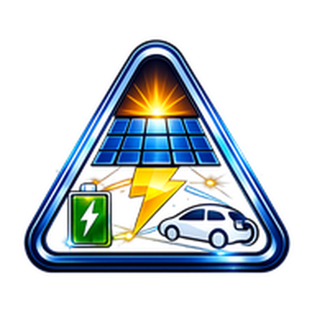
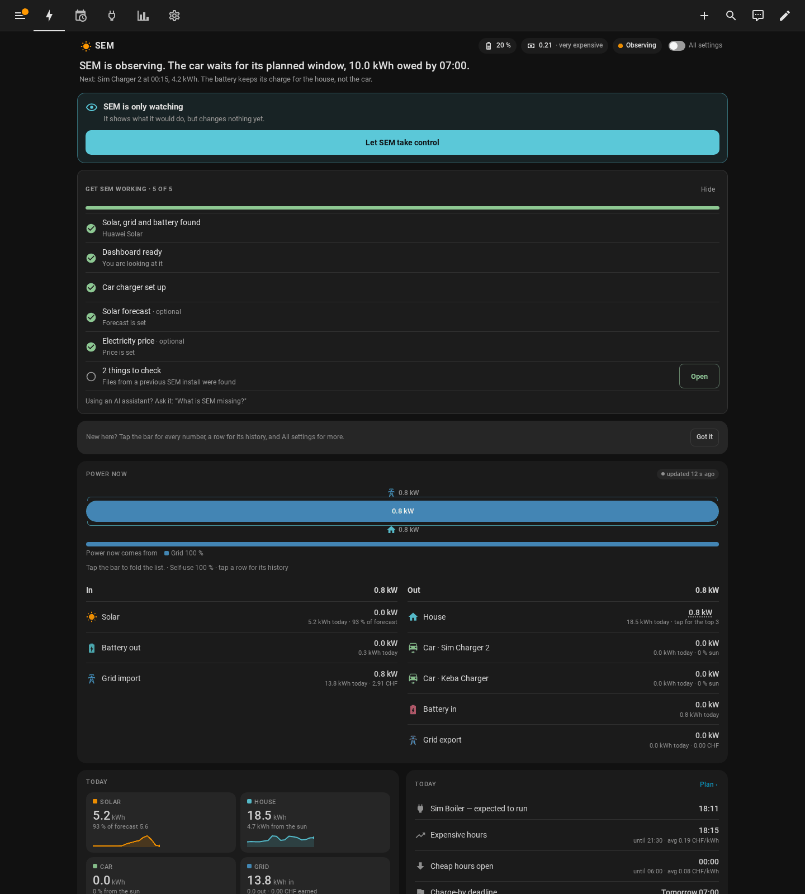

<p align="center">
  
</p>

# User Guide

Solar Energy Management (SEM) runs your solar, battery, car charger, heat pump
and loads. This guide covers daily use and the settings.



## Contents

1. [First setup](#first-setup)
2. [The five screens](#the-five-screens)
3. [Settings](#settings)
4. [Charge the car](#charge-the-car)
5. [Battery](#battery)
6. [Loads and priority](#loads-and-priority)
7. [Hot water and heat pump](#hot-water-and-heat-pump)
8. [Tariff and peak limit](#tariff-and-peak-limit)
9. [Watch only and control](#watch-only-and-control)
10. [Notifications and hints](#notifications-and-hints)
11. [Voice and AI assistant](#voice-and-ai-assistant)
12. [Replay (simulation)](#replay-simulation)
13. [Why did SEM do that?](#why-did-sem-do-that)
14. [Forecast and PV health](#solar-forecast)
15. [Sensors](#sensors-reference)
16. [Fix a problem](#fix-a-problem)
17. [Remove SEM](#removing-sem)

---

## First setup

1. Install SEM with HACS, then restart Home Assistant.
2. Go to **Settings > Devices & Services > Add integration > Solar Energy Management**.
3. SEM finds your sensors and devices. Check each one. Fill in what it missed.
4. Open the **SEM-dashboard** (older installs: **Solar Energy Management**) in the sidebar. The **Now** screen shows a
   setup checklist.
5. SEM starts in **watch only**. It reads and decides, and sends no commands.
   When you are ready, press **Let SEM take control** on the checklist.

### What you see depends on your hardware

SEM shows a row or a card only for hardware you have.

| You have | You get |
|---|---|
| A home battery | Battery card and battery settings on **Devices** |
| A car charger | Charger card on **Devices** |
| A heat pump or hot water | Heat pump and hot water rows on **Devices** |
| A tariff with cheaper hours (dynamic, or a schedule or two rates) | Price settings and the cheapest-hours charge mode |
| A forecast integration | Forecast rows and forecast spending |
| A grid power limit | Peak limit rows |

A setting that your hardware cannot use is not shown. When SEM has not
checked yet, it shows the setting.

---

## The five screens

Open the dashboard. Five screens answer five questions.

| Screen | Question | What you do there |
|---|---|---|
| **Now** | What is SEM doing, and why? | See the power flow, today's totals and the reason for each device. Open **Plan**, **Decisions** or **Insights** from here. |
| **Plan** | What will SEM do next? | See the next 24 hours as a timeline. Skip or start a car for one night, go back to plan, charge now, sell, or replan. |
| **Devices** | How is each device set up? | Change the mode, targets, levels and priority of each charger, battery and load. Rows write at once. |
| **Insights** | How did it go? | Pick a period (Today, Yesterday, Week, Month, Year). Tabs: Energy, Power, Battery, Car, Money, Forecast, Replay. |
| **System** | Is everything connected? Where do I change a setting? | Check sources and health. Change every setting as a row. |

Each screen opens with one line in plain words. Items that have no data
are left out.

---

### Where is it?

| Setting | Screen | Row |
|---|---|---|
| Charger name | **Devices**, charger card | **Name in SEM** |
| Car battery size | **Devices**, charger card (turn on **All settings**) | **Car battery size** |
| Night start and end | **System > Notifications and more** | **Night starts, minutes after sunset**, **Night ends** |
| Tariff | **System > How I pay** | **Tariff mode** |
| Battery reserve | **Devices**, battery card | **SEM sells down to no lower than** |
| Heat pump or room temperature | **Devices**, heat pump card | **Keep at**, **Never colder than** |
| Hot water top for spare sun | **Devices**, hot water card | **With spare sun, heat up to** |
| Hot water maximum | none | SEM never sends more than the water heater accepts |
| May SEM buy power for a heater? | **Devices**, heater card | **May SEM buy power for it?** |

## Settings

### How a setting row works

- The name is on the left. The value is on the right.
- Tap a row. A small dialog asks for the new value.
- To rename a charger, tap the **Name in SEM** row on its card on **Devices**. Entity ids do not change.
- An on/off setting is a switch on the row.
- **Devices** rows save at once.
- **System** rows are collected. Press **Apply** at the bottom to save them together.
- **Everyday** shows the rows you use most. **All settings** shows every row.
  Your choice is kept per browser.

### Choices

- Choices are rounded chips or a list with a tick.
- On a phone, a long list becomes one chip. Tap it to open a picker.

### Actions that ask first

These change behaviour right away. SEM asks you to confirm:

- Turn watch only on or off
- Flip a sign (grid or battery)
- Replan
- Clean up history
- Pause
- Sell from the battery
- Boost a load
- Operate a grid relay

### The seven groups on System

Each group has a short sentence and then its rows.

| Group | What it holds |
|---|---|
| **How I pay** | Tariff mode, prices, taxes, fees, VAT, export price |
| **What SEM may do** | Peak limit, load management, AC limit, export guard, virtual power plant |
| **Battery rules** | Battery levels (read only, change them on **Devices**), discharge limit, battery wiring, charge scheduler |
| **Chargers** | Add or remove chargers. Charger entities and phases |
| **Heat pump and hot water** | Heat pump entities, hot water entities and temperatures. COP is on the heat pump row on **Devices** |
| **What SEM reads** | Grid, solar, battery and house sensors. Sign checks |
| **Notifications and more** | Hints, update interval, morning check, night, vacation, history, notifications, simulation tab, minimum solar |

Tax, VAT and grid-fee rows appear only when they change the price.

---

## Charge the car

### Pick a charge mode

Set the mode per charger, on **Devices**. There are four.

| Mode | What it does | Use it when |
|---|---|---|
| **Sun** | Spare sun only. **At least** comes from the grid at night. | You want solar only. |
| **Sun + tariff** (default) | Spare sun by day. Buys **At least** in the cheapest hours: at night, in a cheap hour, or with thin sun when that is cheaper. Pauses in peak hours. | You need the car ready by a time. |
| **Now** | Full power until its end: the plan's next block, a time you pick, or when the car is full. | You need the car now. |
| **Off** | Nothing. SEM sends one stop, then leaves the charger alone. | You control the car yourself. |

Each charger also has one switch: **May the battery help the car?** It is
the only battery-help switch. When it is on, the house battery helps only with
spare sun after the house, and only above its **may help** level. Tonight's house
need stays covered. At night it helps only if **Spare sun the battery needs** is 0.

| | Battery help on | Battery help off |
|---|---|---|
| **Sun** | The home battery adds to spare sun, above its buffer. | The home battery stays for the house. |
| **Sun + tariff** | The home battery adds to spare sun. | The home battery stays for the house. |

The switch changes only what the home battery does. **Sun + tariff** buys
from the grid by day the same way with the switch on or off: when tonight is
too short to reach **At least**, in a cheap hour, or when thin sun plus the
grid is cheaper than the night. See
[When Sun + tariff buys by day](#when-sun--tariff-buys-by-day).

Notes:

- The switch starts where your charger already was, so nothing changes on
  update. Now and Off remember it.
- **Sun** with **At least** at 0 never takes grid power.
- **Now** from the **Plan** screen (**Charge now**) runs until this car's
  next block in the plan, or 2 hours when the plan has none. On the charger
  you can pick a time or **until full** instead. Pick another mode to stop it.
- **Now** also works on a charger set to **Off** or paused. When Now ends,
  the charger is **Off** again.
- **Now** ends when the car is unplugged. The next car does not inherit it.
- **Now** picked before the car is plugged in waits for it. Its time counts
  from the plug-in; a time you picked stays that time.
- **Off** does not hold the charger stopped. A wallbox that starts by itself is left alone.
- **Old mode names.** The mode select now has four options. Home
  Assistant refuses the old names in `select.select_option`, and a trigger
  or condition on an old name no longer matches. A Repair names every
  automation or script that still uses one. SEM's own `set_option` service
  still takes the old names. Use the new names:

  | Old name | Now |
  |---|---|
  | Solar only (`solar_only`) | Sun, battery help off |
  | Solar + battery (`solar_plus_battery`) | Sun, battery help on |
  | Solar + cheapest hours / Solar + tariff (`solar_plus_cheap`) | Sun + tariff, battery help off |
  | Min + Solar (`min_plus_solar`) | Sun + tariff, battery help on |
  | Always (max) (`always_max`) | Now, until full |

- **Sun + tariff** needs your prices: the import price and the export
  price, in **System > How I pay**. The export price must be the one you
  are really paid: SEM pre-fills 0.075, and this mode decides with it.

### When Sun + tariff buys by day

Thin sun is spare sun below the charger's minimum power (4.1 kW on three
phases at 6 A). Alone it cannot charge the car, so it goes to the grid at
the export price. **Sun + tariff** can use it: the car charges at its
minimum, on the spare sun plus the grid for the rest.

This works with battery help on or off. With help on, the home battery
must be full or not taking that sun.

SEM does this only for **At least**, and only when it is at least 10 %
cheaper than the cheapest hour still to come before **Charge by**:

| Your tariff | What happens with thin sun |
|---|---|
| One price all day, export pays less than import | The car charges at its minimum, from enough sun to save 10 %. Example: import 0.30, export 0.075: from about 0.55 kW of spare sun. |
| Export pays the same as import (net metering) | The car waits. Exporting now and buying at night costs the same. |
| Two rates, night cheaper | The car charges only with more sun. Example: day 0.30, night 0.20, export 0.06: from about 2.1 kW of spare sun. |
| Dynamic | SEM compares this hour with the cheapest hour to come. A cheap hour tops up as before. |

It does not buy by day when:

- strong sun is forecast later today and covers **At least**,
- the home battery is charging from that sun, or may feed the car itself,
- the hour is an expensive one, or the peak limit has no room,
- no export price is stored, or SEM has no forecast.

The plan on **Plan** shows these hours as **Spare sun plus grid**. The car
charges this way only in the hours the plan shows. With a home battery the
plan shows them only when the battery is full: a battery with room takes
that sun first.

A session that started runs for at least the charger's minimum block
(15 minutes), so a cloud does not switch the car off and on. It still stops
at once when **At least** is reached, the car is unplugged, the hour turns
expensive, the peak limit is near, the home battery starts to feed the car,
or the sun is gone.

After a restart of Home Assistant the car waits for the next plan before
it charges this way again. Until then the mode works as before: spare sun
by day, **At least** at night.

### Set the target

| Setting | Meaning |
|---|---|
| **At least** (Min) | The energy that is always secured. Grid power tops it up at night. |
| **Up to** (Max) | The limit for sun. Sun charges up to this, then stops. |

- Units: kWh, or car charge % when the car reports its level.
- Example: **At least 50 %, Up to 80 %** keeps 50 % always, and lets sun
  charge only up to 80 %.
- **Charge by** is the time the car must be ready. A time before night
  ends makes the charge faster.
- **Finish by departure** keeps charging after night ends until the
  **Charge by** time, from the grid. With time to spare, it waits for the
  cheapest hours the plan shows. Otherwise it charges at the lowest current
  that makes it. It does not wait with a peak limit, a grid operator relay,
  a phase guard that acts, or a second charger. Off by default.
- **Departure calendar** takes the departure from a calendar event.
- **Set once** copies this charger's values into the defaults for new chargers.

### Pause

- **Pause charging** on a charger sets its mode to Off for 30 minutes to 12 hours.
  The mode returns after the time.
- Change the mode by hand, and the pause ends.

### Night

- Both night settings are on **System > Notifications and more**.
- Night starts at sunset plus **Night starts, minutes after sunset**
  (0 to 400, default 30).
- Night ends at sunrise, or at **Night ends** (default 07:00), whichever is first.
- Night charging follows the charge mode. There is no separate night switch.

### Battery help for the car

- Whether the battery helps a car is that charger's switch **May the battery
  help the car?** (on the charger card). There is no second switch on the battery.
- **Spare sun the battery needs** is the spare sun after the house before the
  battery helps a car (default 1200 W). It is on the battery card on **Devices**,
  with the other help levels, under "Used when a charger allows battery help."
  Below it the battery helps only when tonight's forecast budget is positive, or
  in a morning window you opened. At 0 W it may also help at night.
- The battery help levels are set on the battery row. See [Battery](#battery).

### Car charge levels

- Without a car sensor, SEM estimates the car's level from the energy sent.
  The estimate is corrected when the car reports its own level.
- An estimate needs a starting point: a car reading, or a charge that slowed
  down to the end while the charger still offered power. Until then the card
  shows no level, only the kWh progress.
- A stop made by the charger, an app or another system is never read as
  "full". When the car is full, the bar says "Car full" instead of "to go".
<a id="slow-polling-soc-sensors-energy-accounted-ceiling"></a>
- Some car sensors update only every 20 to 30 minutes. A session can then
  overshoot the target. SEM also counts the energy sent since the last reading,
  so it stops in time. A fresh reading always wins. The estimate stops a little
  early, never late. The car card's small line shows the estimate.

### Chargers and phases

- Add a second or third charger with **Add a device** or **Add or detect a charger**.
- Priority decides which charger gets spare sun first.
- Phase switching (1 or 3 phase) is on the charger, when the wallbox supports it.
  With phase mode **Auto**, SEM starts an idle car on 1 phase when the spare sun
  covers 1 phase at the lowest current but not 3 (for example 1.4 kW to 4.1 kW
  at 6 A). The sun must hold for 5 minutes first.
- When the night starts, SEM sets a charger it had put on 1 phase back to its
  configured phases, so a grid charge runs at full power. A grid charge that is
  already running on 1 phase is switched up if 1 phase cannot reach the target
  in time, or if there is no time to judge by.
- SEM forgets the phase count when the plug sensor says the car is unplugged.
  The next car starts on the configured phases. A charger without a plug sensor
  keeps it.
- A car that charges on 1 phase only is left alone for that plug-in, when the
  charger reports its current on each phase for about a minute.
- SEM goes back to the configured phases at night only when it has grid energy
  to buy that night. With nothing to charge, the charger stays on 1 phase.
- A car that stays plugged in for days gets up to two switches a day: up to the
  configured phases at night, down to 1 phase in the next day's thin sun. Switches
  made while nothing is charging do not count toward the 4 automatic switches
  allowed under load. Per charger, SEM makes at most 6 such switches a day.
- On some wallboxes the phase switch is shared by every charger on the same
  installation, and a switch moves them all. SEM does not know which chargers share
  one. Turn phase switching on for only one of them.
- The values for 1 phase and 3 phases must be inside the range of the number
  entity they are written to. The forms and the dashboard refuse a value that
  is not. For a stored one, SEM sends no phase switch and raises a Repair.

### KEBA

- SEM never sends an authorize command to a KEBA.
- At each stop SEM sets the wallbox's fallback current to 0 A. A box that
  switches itself on again after about 10 minutes raises a Repair. To make the stop
  hold, set the wallbox's failsafe current to 0 A on the wallbox itself.

---

## Battery

### Battery modes

Set the mode per battery, on **Devices**.

| Mode | What SEM does | Use it when |
|---|---|---|
| **Auto** (default) | The inverter runs the battery. SEM steps in only to charge from the grid for a cheap or negative price, sell in the sell hours (if selling is on), hold the battery for a plugged-in car, or hold it for grid-funded loads. | Normal use |
| **Self-consumption only** | As Auto, but never sells to the grid. | Keep the battery for the house |
| **Force charge** | Charges to 100 % at the highest power, at any price. Goes back to Auto at 100 %. | You want a full battery now |
| **Force discharge** | Sells at the highest power down to the reserve. Goes back to Auto when done. | Manual sale or backup |
| **Off (SEM hands-off)** | Hands the battery to the inverter once. SEM sends nothing after that. | Manual control or testing |

Notes:

- Force charge does not wait for a cheap hour.
- The **reserve** (default 20 %; on the battery card on **Devices**: **SEM sells down to no lower than**) stops SEM's own sales. It does not stop the
  house from using the battery. The inverter's own limit does that.
- Force discharge does not sell while SEM cannot read the battery level.

### Battery levels

On **Devices** the battery shows three levels:

| Level | Setting | Meaning |
|---|---|---|
| Below this the battery fills first | Priority level (default 30 %) | All spare sun goes to the battery. The car waits. |
| From this the battery may help the car | Buffer level (default 70 %) | Below it the battery stays for the house. |
| From this it may help fully | Auto-start level (default 90 %) | Still only with enough spare sun. |

- **Battery size** (kWh) sets how much energy the battery holds.
- **SEM sells down to no lower than** (the reserve) is the lowest level for sales.
- **Spare sun before the battery helps** is on the same card (see [Battery help for the car](#battery-help-for-the-car)).

### Battery settings in **System > Battery rules**

- **Discharge limit entity**: the number entity that limits the inverter's discharge.
  Huawei is found automatically.
- **Forcible-discharge power entity**: sets the discharge power for a forced sale.
- **Charge switch** and **Charge target level**: for a grid charge from the battery.
  Shown only with one battery.
- **End-of-charge level** and **End-of-discharge level**: the inverter's own limits.
  SEM reads them and counts from there.
- **How SEM sends the power value**: how SEM's watts reach the inverter.
  - **Plus discharges, minus charges** (default).
  - **Plus charges, minus discharges**.
  - **A selector sets the direction**: the **Charge or discharge selector** picks the direction, then the watts follow.
- **Charge-power limit entity**: used by Charge pacing.

### Battery features

- **Charge pacing**: fills the battery by the time the price turns, using the
  charge-power limit entity you name. Writes at most once every five minutes.
- **Discharge protection**: during night charging the battery
  powers only the house. The limit follows the house load in 250 W steps.
  It rises when the house draws more. It drops about a minute after the house draws less.
  It stops when night charging ends or when the car is unplugged.
- Discharge limit also caps charging (an option): when the sun covers the house
  and the car draws nothing for 15 minutes, the limit is lifted so the sun charges the battery.
- **Keep the battery for the peak limit**: the house buys up to the peak limit,
  and the battery covers the rest.
- **Morning EV window**: before departure, empties the battery into the car,
  down to the morning drain floor.

### Forecast-led spending

<a id="forecast-led-spending-v21"></a>

SEM can spend tonight's battery energy on the car, or sell it, when tomorrow's sun
will refill it.

- The **spendable** figure is shown on **Devices** in kWh.
- Three states: **Learning** (SEM needs five nights and spends nothing),
  **Holding** (no spare energy), **Spending** (a budget for tonight).
- The car stops above the higher of the buffer level and the computed floor.
- One switch on the battery card: **May the battery sell to the grid?** Battery help for a car is each charger's own switch.
- Start faster from history: the action **Learn overnight battery use from past
  history** and the forecast action **Learn forecast accuracy from past history**
  read your recorder history.

---

## Loads and priority

### Load modes

Set the mode per load, on **Devices**.

| Mode | SEM starts it? | SEM stops it at a peak? | Use it when |
|---|---|---|---|
| **Off** | No | No | You only want to watch it |
| **Peak only** | No | Yes | You want SEM to pause it at a peak |
| **SEM runs it** | Yes, on spare sun | Yes | Pool pump, boiler |
| **SEM runs it, battery may help** | Yes, on spare sun and battery help above the buffer | Yes | Loads that ride through clouds |

- A new load starts at **Off**. SEM controls a device only after you turn it on.
- SEM never lists or switches a security device: one with a camera, alarm,
  door lock or siren in Home Assistant. Its energy still counts in the home total.
  An appliance with a child lock is still a load. A Repair names any device SEM
  no longer uses.
- SEM sheds loads at a peak only when they can cover at least a quarter of
  the excess. Smaller loads stay on, and loads it shed come back.
- Whether SEM buys grid power for a load is set by **May SEM buy power for it?**
  See [A heater's four questions](#a-heaters-four-questions).
- Loads without an on/off switch but with a watt number (for example a
  heating element) are set to the watts SEM has to spare.

### Priority and requirements

- Priority is the order: 1 gets spare sun first.
- **Requires** makes a load run only when another load runs.
  Shedding a parent also sheds its children.
- **Name in SEM** gives a load your own name. Empty the field to use the
  Energy Dashboard name again.

### Peak shedding

SEM watches the 15-minute average. When the grid draw nears the limit,
SEM switches loads off, starting with the lowest priority. When the peak has
passed, SEM turns back only the loads it switched off.

| State | What happens |
|---|---|
| Normal | Nothing |
| Warning | Alert. The limit is close. |
| Shedding | One load at a time, until the draw is under the aim. |
| Emergency | As many loads as needed, at once. |

- **Never switch off** keeps a load on. Routers, modems, NAS and Home Assistant
  hosts are guarded by default.
- After a restart, SEM turns back on a load it switched off.
- Shedding only acts on loads that SEM may control. A load you switch on
  yourself is never stopped by SEM.
- A shed load you turn back on yourself is no longer shown as shed. The other
  shed loads still come back.

<a id="no-grid-limit"></a>
<a id="load-management-settings"></a>

### Grid limit

- **Limit grid draw to**: a number in kW, or **No limit**.
- **No limit** turns peak shedding off and lets SEM size the car from surplus alone.
  **Load management** off means the limit still applies to the car, but loads are not shed.

---

## Hot water and heat pump

<a id="a-heaters-four-questions"></a>

### A heater's four questions

A heater with a thermometer has four questions. The same questions are on
**Devices** and in the Load Priority card.

| Question | Setting | What it means |
|---|---|---|
| Keep at | **Keep at** | The temperature to keep. Spare sun heats to it. |
| Never colder than | **Never colder than** | Below this, SEM heats at once, at any price. |
| Spare sun may heat up to | **With spare sun, heat up to** | How hot free sun may heat it. |
| May SEM buy power? | **May SEM buy power for it?** | **No, sun only**, **Yes, in cheap hours**, or **Yes, from the house battery at night** (only with a house battery). |

Extra notes:

- **Also in the cheapest-heat hours**: heats above *Keep at* in cheap hours only.
- With **Yes, in cheap hours**, SEM plans the heating before the temperature falls to **Never colder than**. It learns how fast the room or tank cools.
- A heater with no thermometer asks **Run it each day for** instead.
- A cooling unit asks the same questions, turned round.
- Away mode: no keep-at runs, nothing bought. Only the never-colder limit heats.
- SEM sends only temperatures inside the device's own range. If the device refuses one, SEM waits 5, 15, then 60 minutes before it tries again.

### Order of decisions

1. The stop temperature is reached: stop.
2. A Legionella run is due: run to its target.
3. The tank is colder than **Never colder than**: heat now.
4. The tank is below **Keep at**, SEM may buy power and the cheap hour is open: heat.
5. Night, house battery chosen, battery above its reserve: heat from the battery.
6. Spare sun: heat up to **With spare sun, heat up to**.

**Why now** on **Now** names the step that decided.

### Hot water

- **Hot water solar target**: the top temperature for sun. With a thermometer band it is the same as **With spare sun, heat up to** on the hot water card on **Devices**.
- **Legionella temperature** and **Legionella interval**: SEM must reach the
  Legionella temperature on a set schedule. This cycle cannot be turned off.
- A run that the tank does not finish is not counted. SEM tries again after one full interval.

### Heat pump

- **SG-Ready contacts** or a **climate entity** or a **service call**: how SEM
  drives the pump. Choose what you have.
- **Boost offset**: how much SEM raises the setpoint for a surplus run.
  SEM puts back the old setpoint after the run.
- **Step down when power is short**: off, lower the setpoint, or send the blocked signal.
  SEM uses it in an expensive hour, or near the peak limit. A step-down lasts at least 15 minutes.
- **Own tariff**: a fixed rate or price entity for a heat pump on its own meter.
- **COP by outdoor temperature**: two or three points, for example "-7 °C: 2.5, 12 °C: 4.2".
  Leave empty for one fixed COP. The COP follows the outdoor temperature only
  once you set this curve.
- **COP used**: **Fixed COP** or **Learned**.
- **Heat meter**: a kWh total meter. SEM learns the COP from it.
- **Heat or cool by the outdoor forecast**: the season follows the next day's forecast.

---

## Tariff and peak limit

### Tariff modes

Set under **System > How I pay > Tariff mode**.

| Mode | Use it when | What SEM does |
|---|---|---|
| **fixed** | One rate, or a day and night rate | Uses your rates. |
| **dynamic** | Tibber, Nordpool, aWATTar, ENTSO-e, Amber, Octopus | Reads live prices. Shows cheap and expensive hours. |
| **by schedule** | A fixed time-of-use tariff | Uses a schedule helper for the peak hours. |

- With **Dynamic**, pick the price entity, or let SEM find it.
- SEM finds Amber and Octopus feed-in rates on their own.
- Cheap and expensive hours: **Cheap below** and **Expensive above**, or the classification mode **by price range** or **fixed thresholds**.

<a id="taxes-markup-and-feed-in-fee"></a>

### Price basis

- **All-in (taxes included)**: your price already includes tax and VAT. SEM adds nothing.
- **Spot price incl. VAT**: a market price with VAT.
- **Spot price (no taxes)**: a bare market price. Markup, tax and VAT are added.

The **preset** **Netherlands from 2027** fills tax and VAT.

### Feed-in fee and export

- **Feed-in fee**: **Per kWh**, **Tiers by kWh per year**, or **Fixed per month**.
- **Stop exporting below**: SEM stops selling when the price is below this
  after the fee. Default 0. It needs the export guard.
- **Export guard**: while the export price is negative, SEM caps the feed-in at zero at
  the inverter. It needs a dynamic feed-in price. Huawei, Deye and other brands are supported.
- An option lets the car start on negative export and buy the missing watts.

### Peak limit

- Set **Limit grid draw to** on **Devices** or under **System > What SEM may do**.
- Your limit is your grid connection size, from your contract or main breaker.
- A new install stores 4.5 kW for the warning level and 6.0 kW for the emergency level. Set them under **All settings**.

---

## Watch only and control

- **Watch only** is the one name for observer mode.
- Turn it on or off with the **watch only** switch on **System > Health**.
- In watch only:
  - SEM reads everything and shows what it would do.
  - Device actions are blocked and say **Watch only: not sent**.
  - SEM's own settings stay editable.
- Turning watch only off also turns on plan execution if it was off. Turning it on leaves plan execution as it is.
- A new install starts in watch only.
- A device another party steers: set **Steered by another party** on the device.
  Choose to yield (SEM writes nothing while the steering indicator is on) or
  to keep control and get a Repair when SEM sees writes it did not make.
  If you yield and pick no indicator, SEM always yields.
  The one exception to yielding: if a phase is over its limit and the phase guard
  enforces, SEM stops that charger. SEM switches it back on when the guard is
  armed again and every phase has room for the charger's earlier draw. With two
  chargers, one at a time, highest priority first. The charger shows **Stopped by
  the phase guard** meanwhile. If the other party switched it on itself, or the
  car leaves, SEM does nothing more. If the phase goes over again soon after, or
  the charger is not on again within 5 minutes, SEM waits 10, then 20, then 40
  minutes. If it fails once more, SEM stops and a Repair says the charger was
  left off. A second charger waits until the first car draws. A stop SEM sent
  as a wallbox service or a button, not a switch, number or select, is not
  switched back: the Repair says so at once. After 12 hours SEM no longer
  switches a charger back on.

---

<a id="hints"></a>

## Notifications and hints

- **Mobile notifications**: pick the notify service in **Notifications and more**.
  `notify.mobile_app_*` gets the full Android options. Other services get the message and title.
- **Charger notifications**: show the status on the charger display, where the charger has one.
- **Hints**: **Off**, **Weekly note**, or **All hints**.

| Hint | When it is sent |
|---|---|
| An input stopped sending | A sensor SEM reads was silent for 15 minutes |
| A load ran all night | The night's draw was 1.5 times the usual |
| Grid use rose | Grid use was 1.5 times the usual, with the same sun |
| Power is cheap, car idle | Cheap price, car plugged in and not charging (a tariff with cheaper hours) |
| Weekly summary | The first night on a Sunday |

Each hint is one message. Automations can use the event
`solar_energy_management_notification` with `category: hint`.

---

## Voice and AI assistant

### Voice commands

- Turn on **Voice commands** under **Settings > Devices & Services > SEM**.
- Without it, Assist can explain but not act.
- Questions (always on):
  - "why is the battery doing that"
  - "why is the car charging" / "why is the car not charging"
  - "what will tonight cost"
  - "is now a good time to charge"
- Changes (need Voice commands on):
  - "charge the car to 80 percent"
  - "don't charge the car tonight"
  - "charge the car now, for 30 minutes" (leave out the minutes for one hour)
  - "charge normally again"

### AI assistant

An AI assistant in Home Assistant can use SEM's tools. Ask it in your own words.

- AI assistants and MCP clients (such as Claude Desktop) see the tools as
  `solar_energy_management__SemSetupStatus` and so on. The intent names in
  sentence files stay the same.
- `solar_energy_management__SemSetupStatus` (read-only) tells the assistant how SEM is set up.
- The four change tools appear only when Voice commands is on.
- `solar_energy_management__SemDraftIssue` prepares a bug report. It posts nothing. Check the text,
  attach the diagnostics file and submit it yourself. Tokens, e-mail addresses and
  entity names are removed.

### Custom sentences (without an AI assistant)

Create `config/custom_sentences/en/solar_energy_management.yaml`:

```yaml
language: "en"
intents:
  SemWhyBattery:
    data:
      - sentences:
          - "why is the battery (doing that|like this)"
  SemWhyCharger:
    data:
      - sentences:
          - "why is the car (charging|not charging)"
          - "why is [the] {name} (charging|not charging)"
  SemTonightCost:
    data:
      - sentences:
          - "what will tonight cost"
  SemGoodToChargeNow:
    data:
      - sentences:
          - "is now a good time to charge [the car]"
  SemSetChargerTargetSoc:
    data:
      - sentences:
          - "charge [the] [car] to {percent} percent"
  SemSkipChargerTonight:
    data:
      - sentences:
          - "don't charge [the] [car] tonight"
          - "don't charge [the] {name} tonight"
  SemForceChargeNow:
    data:
      - sentences:
          - "charge [the] [car] now"
          - "charge [the] [car] now for {minutes} minutes"
  SemClearPlanOverride:
    data:
      - sentences:
          - "charge [the] [car] normally [again]"
```

Restart Home Assistant. Test each sentence under **Settings > Voice assistants >
Expose > Debug** first.

### Skip or force one night

On **Plan**, use **Skip**, **Start now** or **Charge now**. They last until the
set time, at most one day. Force does not beat safety: a full car, a
disconnected car, hands-off, and the peak limit still stop it.
**Back to plan** ends the override.

---

<a id="simulation-tab-1083"></a>

## Replay (simulation)

Replay answers "what if?" for days you already had. Every number is an estimate.

### Switch it on

**System > All settings > simulation tab**. Only a Home Assistant administrator
can use Replay.

### Pick a period

- **Last 30, 90 or 365 days**, a **Month**, or **Most recent days** (slider).
- A battery carries its charge from day to day, so a run is always a whole period.
- A day with a data gap is left out.
- At most 365 days per run.

### Change the what-if

- Battery size (up to 150 kWh), charge and discharge power, reserve.
- Peak limit, solar size (extra kWp), import price and export value.
- Battery mode, car charge mode, and whether the battery may help the car.
- **Scenarios** fill the fields in one tap, for example **Cars on Solar + cheap**.

### Read the result

- **Net incl. stored energy** is the headline. It counts the energy the
  simulated battery still holds.
- Green days are cheaper, orange days are dearer.
- Tap a day for its flows and the reason for each decision.
- Day-type tiles are filters. They do not change the result.
- **est.** means estimated. **Rough estimate** days had gaps. Read them as a rough guide.
- Before a what-if, SEM replays your own settings. Up to 5 % error shows as is.
  From 5 % to 10 %, a note is shown. Above 10 %, the tab says the period
  cannot be simulated reliably.
- **Download** saves an .xlsx file.

---

## Why did SEM do that?

Open **Logbook** in the sidebar. SEM writes a line when it changes a command:

    <device>: <old command> → <new command> — <reason>

- A line appears only on a change. The same command twice writes nothing.
- In watch only, the line ends with *(observer: not sent)*.
- The diagnostics download keeps the last 200 lines.

---

## Solar forecast

Install a forecast integration: Solcast, Forecast.Solar, Open-Meteo or Helios.
SEM finds it. Choose the source with the forecast row under **System**.

- With two or more, SEM scores each one against your real yield, after scaling.
- **PV health** (`sensor.sem_pv_health`) compares the last seven days of yield with the
  forecast. Green 85 % or more, yellow 65 to 85 %, orange 40 to 65 %, red under 40 %.
  It shows `unknown` until three days are in.
- **Grid CO₂**: SEM finds the sensor by its unit. Pick another under **System** if needed.

---

## Sensors reference

Power sensors are in watts. Energy sensors are in kWh. Costs are in your currency.

<a id="energy-sensors-kwh"></a>

### Main sensors

| Sensor | Meaning |
|---|---|
| `sensor.sem_solar_power` | Solar production now |
| `sensor.sem_grid_power` | Grid: + export, − import |
| `sensor.sem_battery_power` | Battery: + charge, − discharge |
| `sensor.sem_ev_power` | Car charging power, all chargers |
| `sensor.sem_home_consumption_power` | House draw, without the car |
| `sensor.sem_daily_solar_energy` | Solar today (kWh) |
| `sensor.sem_daily_grid_import_energy` | Grid import today (kWh) |
| `sensor.sem_daily_grid_export_energy` | Grid export today (kWh) |
| `sensor.sem_daily_ev_energy` | Car energy in the current EV day (kWh) |
| `sensor.sem_self_consumption_rate` | % of solar used at home |
| `sensor.sem_autarky_rate` | % of use covered by solar and battery |
| `sensor.sem_charging_state` | Current charging state and per-charger reasons |
| `sensor.sem_energy_plan` | The plan for the next hours |
| `sensor.sem_battery_spendable_kwh` | Tonight's spendable battery energy (unknown while learning) |
| `sensor.sem_load_management_status` | Peak state and the shed decision (attribute `shed_path`) |
| `sensor.sem_pv_health` | PV health colour (see [Solar forecast](#solar-forecast)) |

### Day boundaries

- Solar, grid and home counters reset at midnight.
- The car energy counter resets at the charger's **Charge by** time, so an
  overnight charge stays in one day.

### Source of stored energy

- `sensor.sem_daily_battery_charge_solar` and `sensor.sem_daily_battery_charge_grid`
  split the battery's charge by origin.
- `sensor.sem_daily_savings` counts only the difference between the price paid for
  stored grid energy and the price it replaces.

### Other sensors

- `sensor.sem_true_baseload_power` and `sensor.sem_daily_true_baseload_energy`: the
  part of the house that SEM does not control.
- `sensor.sem_house_meter_power` and `sensor.sem_house_meter_gap`: the house figure
  your inverter reports, and the difference from SEM's figure.
- `sensor.sem_charger_{id}_estimated_soc` and `sensor.sem_charger_{id}_vehicle_soc`:
  the car's level estimate and the car's own level.
- `sensor.sem_ev_remaining_range`: estimated range in km.

---

## Fix a problem

| Problem | What to do |
|---|---|
| Grid import shows 0 kWh while you draw from the grid | The grid sign is wrong. On the grid row use **flip sign**, or **reset sign detection** under **All settings**. |
| A wrong sensor is used | **System > What SEM reads**. Pick the right entity. |
| A power sensor shows the wrong unit | Pick a sensor that reports watts. Amps are not accepted for power. |
| The car does not start | Check the charge mode and **Charge by**. Check the car sensor and the wallbox. |
| The wallbox restarts itself after a stop | See [KEBA](#keba). |
| A device is controlled by someone else | Set **Steered by another party** on the device, under **All settings**. |
| The dashboard is blank after an update | Hard-refresh the browser (Ctrl+Shift+R). |
| Cards show "Custom element doesn't exist" | Restart Home Assistant and hard-refresh. |
| Repairs are open | Open **Settings › System › Repairs** and read each one. Some name the entity to check. |
| The Repair "Old SEM dashboard is still there" | Delete the old dashboard, or keep it. See [Coming from the classic dashboard](DASHBOARD_GUIDE.md#coming-from-the-classic-dashboard). |

Use **Diagnose** on **System** to copy a report for an issue.

---

<a id="configuration-options"></a>

## Setting names and where they are

Older docs and automations use setting names. This table gives each one's
default and its place now. Values are in the units shown.

| Setting | Default | Where now |
|---|---|---|
| `observer_mode` | true | System > Health, watch only |
| `update_interval` | 10 s | System > Notifications and more, Update every |
| `daily_ev_target` | 10 kWh | Devices > charger, At least |
| `daily_ev_target_max` | — | Devices > charger, Up to |
| `ev_target_type` | kWh | Devices > charger, unit (kWh or car %) |
| `ev_target_soc` | 80 % | Devices > charger, At least, in car % |
| `ev_target_soc_max` | — | Devices > charger, Up to, in car % |
| `ev_battery_capacity_kwh` | 40 kWh | Devices > charger, Car battery size (All settings) |
| `ev_charging_mode` | — | Devices > charger, Charge mode |
| `ev_connected_sensor` | — | System > What SEM reads, car plugged in |
| `ev_charging_power_sensor` | — | System > Chargers, Power sensor |
| `ev_phase_switch_entity` | — | System > Chargers, Phase switch entity |
| `ev_phase_switch_value_1p` | — | System > Chargers, 1-phase value |
| `vehicle_soc_entity` | — | System > Chargers, Car charge level sensor |
| `min_solar_power` | 1000 W | System > All settings, min solar |
| `dynamic_feedin_entity` | — | System > How I pay, Feed-in entity |
| `battery_capacity_kwh` | 15 kWh | Devices > battery, capacity |
| `battery_priority_soc` | 30 % | Devices > battery, fill first below |
| `battery_buffer_soc` | 70 % | Devices > battery, car may get help from |
| `battery_auto_start_soc` | 90 % | Devices > battery, car may get full help from |
| `battery_assist_max_power` | 4500 W | Devices > battery, help to the car |
| `battery_assist_min_surplus` | 1200 W | Spare sun before the battery helps, on the battery card |
| `battery_discharge_protection_enabled` | true | Devices > battery, discharge protection |
| `battery_max_discharge_power` | 5000 W | Devices > battery, max discharge |
| `battery_discharge_control_entity` | — | System > Battery rules, Discharge limit entity |
| `battery_force_discharge_control_entity` | — | System > Battery rules, Forcible-discharge power entity |
| `battery_setpoint_model` | signed | System > Battery rules, How SEM sends the power value |
| `battery_power_direction_entity` | — | System > Battery rules, Charge or discharge selector |
| `load_management_enabled` | false | System > What SEM may do, load management |
| `target_peak_limit` | 5 kW | Limit grid draw to (Devices or System) |
| `peak_limit_unlimited` | false | Limit grid draw to, No limit |
| `warning_peak_level` | 4.5 kW | System > All settings, Warning peak level |
| `emergency_peak_level` | 6.0 kW | System > All settings, Emergency peak level |
| `enable_charger_notifications` | true | System > Notifications and more, charger notifications |
| `enable_mobile_notifications` | false | System > Notifications and more, mobile notifications |
| `mobile_notification_service` | — | System > Notifications and more, mobile notifications |

### Options flow only

These fields have no row on the dashboard. Set them in **Settings > Devices &
Services > Solar Energy Management > Configure**:

- `ev_charger_service`: the Home Assistant service that sets the charger current, for example `keba.set_current`.
- `ev_charger_service_entity_id`: the entity the service targets.
- `ev_charging_sensor`: an optional on/off sensor for charging.
- `ev_current_sensor`: an optional sensor for the current in amps.
- `ev_total_energy_sensor`: an optional lifetime energy sensor in kWh.
- `vehicle_range_entity`: the car's range sensor. Without it, SEM estimates the range.
- Charger efficiency: converts metered kWh to kWh in the car (default 92 %). Lower it if SEM's estimate runs ahead of the car. Raise it if it lags.

## Removing SEM

SEM removes its own storage, Repairs, dashboard resources and hardware
commands on uninstall. It undoes only its own commands. It never changes your
car's authorisation.

It keeps your history and the SEM dashboard you made. To remove them too, run
the action **SEM: Remove leftovers** before you uninstall:

| Option | Default | What it does |
|---|---|---|
| `statistics` | on | Clears the recorder's long-term statistics for SEM's sensors |
| `dashboard` | off | Deletes the SEM dashboard, including your edits |

Older storage files are removed on the next setup, and a Repair tells you how many.
